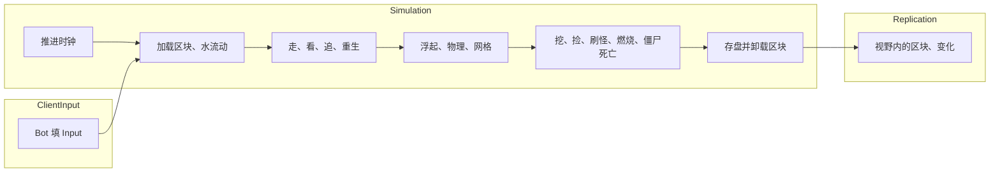

import { Boxes, FlaskConical, Network, Save } from 'lucide-react';

一个仿 Minecraft 服务器的方块世界：每秒 20 tick；玩家周围加载区块，走远后存进区域文件，玩家回来时再读回；水按 Minecraft
的规则扩散和退去，站在水里的东西会被冲走；挖下的方块变成掉落物，谁走过都能捡；僵尸夜里出现，追它看见的玩家，白天在露天会着火；
只把变了的东西发给客户端；服务器停机时存档。50 个 bot 玩一分钟游戏时间。本页所有代码都直接引用自
[`samples/VoxelServer`](https://github.com/JasonXuDeveloper/EasyEcs/tree/master/samples/VoxelServer)。CI 会构建并运行它，
拿输出和下面的结果逐行比对。

它写的是服务器，但里面没有一处只属于服务器：同一个 World 也能放在客户端。客户端跑同样的区块、水和刚体，在服务器的包到达之前先预测；
每个 tick 之后，渲染层读位置和方块画出来。见[客户端与服务器](#client-and-server)。

## 你会学到 [#what-you-learn]

下面每一项都有自己的一节，附上用到它的代码。

- **一个 tick 分三个组**：输入、模拟、同步各是一个[系统组](/zh/docs/guide/systems#system-groups)，各自由
  `world.Update<TGroup>()` 运行（[一个 tick](#one-tick)）。
- **区块是实体，方块和水是两个缓冲**：[唯一索引](/zh/docs/guide/indexes-and-relations#unique-keys)按位置找到区块，
  字节的[动态缓冲](/zh/docs/guide/dynamic-buffers)装它的 8,192 个方块和对应的水（[数据](#data)）。
- **区块跟着玩家走，而且会保留**：用 [`UpdateInterval`](/zh/docs/guide/systems#update-interval) 和
  [`Slices`](/zh/docs/guide/systems#slices) 控制频率，区块连同里面的实体用
  [`SaveEntities` 和 `LoadEntities`](/zh/docs/guide/migration-and-unload) 存下、读回，放在遍历之后做（[区块](#chunks)）。
- **一套视野**：每个[预制体](/zh/docs/guide/prefabs)一个 `Vision`，按区块索引实体的[值索引](/zh/docs/guide/indexes-and-relations#value-indexes)
  当网格，每个观察者一个 `Seen` 缓冲，只在变化时通过 [`Mut<T>`](/zh/docs/guide/change-tracking#set-if-changed) 写入
  （[视野](#aoi)）。
- **水是 SIMD 模板运算**：每个方块同一条规则，用 `Vector128<byte>` 一条指令算 16 个方块，只算还可能流动的区块（[水](#water)）。
- **SIMD 批量方法**：冷却、存在时间和着火在[批量方法](/zh/docs/guide/systems#batch-methods)里一条指令算 8 个（[SIMD](#simd)）。
- **状态变化即数据**：挖掘、掉落物、着火和死亡都是组件和实体（[掉落物](#items)、[僵尸](#zombies)）。
- **自动排好序的排行榜**：按挖掘数索引玩家的[有序索引](/zh/docs/guide/indexes-and-relations#ordered-index)（[排行榜](#leaderboard)）。
- **只发变了的**：[`[Changed<T>]`、`[ChangedAny<..>]`](/zh/docs/guide/change-tracking#changed-any) 和
  [`Maybe<T>`](/zh/docs/guide/systems#maybe)（[下发什么](#replication)）。
- **停机存档**：[`SaveWithout` 和 `LoadKeeping`](/zh/docs/guide/saves#restart)，预制体每次启动重建。
- **可度量**：[`MeasureSystems` 和 `DescribeSchedule`](/zh/docs/guide/diagnostics)。

## 运行 [#run-it]

```bash
dotnet run -c Release --project samples/VoxelServer                      # 50 个 bot，一分钟游戏时间
dotnet run -c Release --project samples/VoxelServer -- --players 2000    # 一大群人
dotnet run -c Release --project samples/VoxelServer -- --realtime        # 像原版服务器一样每秒 20 tick
dotnet run -c Release --project samples/VoxelServer -- --schedule        # 系统的运行顺序
```

## 一个 tick：三个组 [#one-tick]



一个 tick 分三部分，每部分是一个系统组：一个起名用的 struct，加上它的系统上的 `[UpdateInGroup<T>]`。

<include lang="csharp" meta='title="Groups.cs"'>../../../samples/VoxelServer/Groups.cs</include>

宿主按顺序运行这三个组，每组各 Update 一次。真实服务器可以让 `ClientInput` 随包到达就运行，对远处的玩家降低 `Replication` 的频率，
系统一行都不用改。

<include lang="csharp" meta='title="Host/Server.cs"'>../../../samples/VoxelServer/Host/Server.cs#tick</include>

组内的系统按添加顺序运行。系统之间不互相调用：每个系统读写组件，下一个系统看到上一个写下的结果。

<include lang="csharp" meta='title="Program.cs"'>../../../samples/VoxelServer/Program.cs#systems</include>

## 数据 [#data]

先是方块、区块和它的水，然后是会动的东西、玩家、僵尸和掉落物，最后是单例。注释说明每个值的含义和谁来写。

<include lang="csharp" meta='title="Components.cs"'>../../../samples/VoxelServer/Components.cs</include>

规则是常量和几个纯函数；地形负责方块的位置、区块的生成，以及所有系统共用的读取：`BlockAt`（未加载的区块读出来是石头，
所以什么都不会掉出世界）、`WaterAt`、`TopAt` 和一个点周围的区块。

<include lang="csharp" meta='title="Rules.cs"'>../../../samples/VoxelServer/Rules.cs</include>

<include lang="csharp" meta='title="Terrain.cs"'>../../../samples/VoxelServer/Terrain.cs</include>

## 玩家周围的区块 [#chunks]

`ChunkLoadSystem` 每秒两次（`UpdateInterval`）遍历每个玩家视野内的区块：在每个区块上数看见它的玩家（`Viewers`），把缺的区块记成
`LoadRequest` 实体，每个区块一个：请求是 `IUniqueIndexed`，第二个要它的玩家能找到它，给它的计数加一。它不负责加载：遍历期间
不能加载或保存实体（EECS041），所以由 `ChunkReadSystem` 在遍历之后的 `OnUpdate` 里处理这些请求，每个 tick 最多
`Rules.MaxRequests` 个，只销毁处理过的，其余的等下一个 tick。卸载过的区块用 `LoadEntities` 从区域文件读回，里面的僵尸和掉落物也一起回来；从没见过的区块就生成，方块和水各用一次
`AddRange` 写进缓冲。不管哪种，这个 tick 里它都带着 `Fresh` 标签：客户端会整块收到它（见下文），而不是收到方块变化。

<include lang="csharp" meta='title="Systems/Chunks.cs"'>../../../samples/VoxelServer/Systems/Chunks.cs#load</include>

卸载是反过来的同一套做法。`Slices = 20` 让每个 tick 检查二十分之一的区块，五秒没人看见的打上 `Unloading` 标签；
`ChunkSaveSystem` 再把每个区块连同它网格格子里的实体写成一条记录（`SaveEntities`）并销毁，所以没有玩家的地方什么都不跑。有玩家站着的区块（比如刚在那里重生的玩家）不会卸载。
区域文件是一个装着类的单例；[`Host/RegionFiles.cs`](https://github.com/JasonXuDeveloper/EasyEcs/tree/master/samples/VoxelServer/Host/RegionFiles.cs)
代替磁盘。

<include lang="csharp" meta='title="Systems/Chunks.cs"'>../../../samples/VoxelServer/Systems/Chunks.cs#unload</include>

客户端会保留发给它的区块。`ChunkViewSystem` 在玩家身上记着同一个集合，一个 `DynamicBuffer<InView>`：进入视野的已加载区块整块发送，
离开的就让客户端忘掉。这个集合只在玩家跨进另一个区块、或附近有区块加载完时才变，而这两件事本来就是数据：`GridSystem` 只在跨区块时写
`InChunk`，`InChunk` 又是 `ITracked`，所以 `[Changed<InChunk>]` 只访问跨了区块的玩家；`[With<Fresh>]` 访问这个 tick 加载的区块，
把它们加进附近玩家的集合。没有任何轮询：待在原区块的玩家什么开销都没有，跨区块当个 tick 就能看到。

<include lang="csharp" meta='title="Systems/Chunks.cs"'>../../../samples/VoxelServer/Systems/Chunks.cs#view</include>

## 视野（AOI） [#aoi]

一个实体看得见什么，对所有能看的东西都是同一份数据：每个预制体设置的 `Vision`，玩家 32 格，僵尸 35 格（Minecraft 里它的追踪距离）。
视野更远的 Boss 只是多一个预制体，不用写新代码。

<include lang="csharp" meta='title="Program.cs"'>../../../samples/VoxelServer/Program.cs#prefabs</include>

网格是 `InChunk`，一个带索引的组件，挂在所有会动的东西上，所以 `world.InChunkIndex.Find(chunk)` 列出一个区块里的实体。
`GridSystem` 让它保持最新，只在实体跨进另一个区块时才写（`SetInChunkIfChanged`），所以索引每秒只变几次，而不是每个 tick 都变。

<include lang="csharp" meta='title="Systems/Movement.cs"'>../../../samples/VoxelServer/Systems/Movement.cs#grid</include>

`SightSystem` 是唯一的视野系统。它遍历观察者 `Vision` 够得着的区块，把范围内的实体排好序存进 `Seen` 缓冲，再把新旧两个集合
同时走一遍做比较：哪些进入了视野、哪些离开了、哪些在这期间被销毁了（`World.IsAlive` 返回 false）。玩家的客户端据此收到出现和消失的包；
僵尸从同一个集合里挑目标。缓冲只在集合变化时通过 `Mut<T>` 写入，每个 tick 只有十分之一的观察者看一次（`Slices`），
所以人再多，每个 tick 的开销也一样。

<include lang="csharp" meta='title="Systems/Sight.cs"'>../../../samples/VoxelServer/Systems/Sight.cs#sight</include>

因为只在变化时才写，`ZombieTargetSystem` 用 `[Changed<DynamicBuffer<Seen>>]` 过滤：只有看见的东西变了，僵尸才重新挑最近的玩家。

<include lang="csharp" meta='title="Systems/Zombies.cs"'>../../../samples/VoxelServer/Systems/Zombies.cs#target</include>

在 ECS 里，“谁在谁附近”的常规答案就是网格：一个从格子到其中实体的索引，由移动它们的系统维护，由需要邻居的系统读取。
这里的格子是区块，因为区块本来就是加载的单位；人群密集的游戏可以用更小的格子，代码不变。

## 水 [#water]

水不是一种方块，而是方块旁边的第二个网格：每个方块一个字节的 `DynamicBuffer<Fluid>`。方块一变，不管是谁改的，
这个区块和四个邻居的水都会被唤醒（`Flowing`）：`BlockUpdateSystem` 响应方块缓冲的变化，所以挖掘本身完全不用知道水。

<include lang="csharp" meta='title="Systems/Water.cs"'>../../../samples/VoxelServer/Systems/Water.cs#wake</include>

规则是 Minecraft 的简化版（两个泉眼之间不会生出新水源，水向四面扩散而不是流向最近的落差）：水下面的空格变成下落的水；水旁边、脚下踩着实心方块的空格，水位比它低一级；其余的都变空，所以泉眼没了水就会退。
这是一个模板运算（stencil）：每个方块都用同一套算术，从它的六个邻居算出下一步，正是 GPU 在网格上做的那种计算。区块的一行是 16 个方块，
即一个 `Vector128<byte>`，它的邻居就是同一缓冲里相邻的行。先把区块边界外的邻居复制到一个带填充的副本的外圈（halo），向量循环就没有边界情况；
再用两次向量化搜索（`IndexOfAnyExcept`）把计算限制在有水的那几层。字节通道是整数运算：每台机器上的水都一样。
这一步写进第二个缓冲 `NextFluid`，等所有区块都算完，`WaterCommitSystem` 再把它拷成水，就像 GPU 交替使用两个缓冲：每个区块都用邻居
这一步之前的水来算，与区块的访问顺序无关。
一步下来什么都没变，就去掉 `Flowing`，静止的湖不会再被访问。

<include lang="csharp" meta='title="Systems/Water.cs"'>../../../samples/VoxelServer/Systems/Water.cs#flow</include>

`FloatSystem` 把站在水里的东西（玩家、僵尸和掉落物）托起来，推向周围更低的水，就像 Minecraft 的水流。

<include lang="csharp" meta='title="Systems/Water.cs"'>../../../samples/VoxelServer/Systems/Water.cs#float</include>

## 移动 [#movement]

行走把输入变成速度。每一行只依赖它自己，方法也不持有 `World`，所以是并行方法；注释说明了什么时候拆分才划算。

<include lang="csharp" meta='title="Systems/Movement.cs"'>../../../samples/VoxelServer/Systems/Movement.cs#walk</include>

物理让每个物体在方块间移动，通过 `Mut<Position>` 写位置：`SetIfChanged` 只在位置变了时才给这一行打 tick，所以站着不动的物体不会被下发。
它留在单线程，因为它通过 `World`（区块索引）读方块，而并行方法不能持有 World（EECS010）。水、浮起和视野也是同样的原因。

<include lang="csharp" meta='title="Systems/Movement.cs"'>../../../samples/VoxelServer/Systems/Movement.cs#physics</include>

## 挖掘与掉落物 [#items]

挖一下，方块变成空气和一个掉落物（像 Minecraft 一样，草变成泥土），挖的人 `Score` 加一（见[排行榜](#leaderboard)）。
缓冲通过 `chunk.Block[slot]` 读、`chunk.WriteBlock()` 写，所以只有挖掘会给区块打 tick，周围的水也是通过这次打 tick 被唤醒的。

<include lang="csharp" meta='title="Systems/Items.cs"'>../../../samples/VoxelServer/Systems/Items.cs#dig</include>

掉落物每个 tick 长一岁：批量方法一条指令给 8 个存在时间加一（见 [SIMD](#simd)）。

<include lang="csharp" meta='title="Systems/Items.cs"'>../../../samples/VoxelServer/Systems/Items.cs#age</include>

过了拾取延迟，掉落物归站在它上面的任何玩家，同样通过网格找到。同类的堆先长满，空格子装剩下的，装不下的留在地上。
先读背包再写，所以背包满了不会被打 tick。

<include lang="csharp" meta='title="Systems/Items.cs"'>../../../samples/VoxelServer/Systems/Items.cs#pickup</include>

<include lang="csharp" meta='title="Systems/Items.cs"'>../../../samples/VoxelServer/Systems/Items.cs#expiry</include>

## 僵尸与死亡 [#zombies]

夜里每五秒，每个玩家附近出现一只僵尸，像 Minecraft 一样离玩家 24 到 32 格，站在那一列的顶上、不在水里：僵尸预制体的一个实例，
带着自己的 `Position`。

<include lang="csharp" meta='title="Systems/Zombies.cs"'>../../../samples/VoxelServer/Systems/Zombies.cs#spawn</include>

僵尸走向它追的玩家，靠近了就打；玩家离开了也能发现，因为 `TryGetEntity` 对过期的 id 返回 false。追、打和冷却是三个系统，各管一件事。

<include lang="csharp" meta='title="Systems/Zombies.cs"'>../../../samples/VoxelServer/Systems/Zombies.cs#chase</include>

<include lang="csharp" meta='title="Systems/Zombies.cs"'>../../../samples/VoxelServer/Systems/Zombies.cs#attack</include>

着火也是数据：`SunlightSystem` 给白天露天的僵尸加上 `Burning`，在水里则去掉；`BurnSystem` 让火烧下去并扣血；
`ExtinguishSystem` 去掉烧完的火。

<include lang="csharp" meta='title="Systems/Zombies.cs"'>../../../samples/VoxelServer/Systems/Zombies.cs#sunlight</include>

<include lang="csharp" meta='title="Systems/Zombies.cs"'>../../../samples/VoxelServer/Systems/Zombies.cs#burn</include>

死亡就是 `Health` 归零，每种实体一个系统处理：僵尸消失，玩家把背包掉在原地然后重生。`Mut<T>` 只为重生的玩家写位置和背包。

<include lang="csharp" meta='title="Systems/Health.cs"'>../../../samples/VoxelServer/Systems/Health.cs</include>

## 数据成列才用 SIMD [#simd]

这个服务器里有两种数据适合 SIMD：

- **带模板运算的网格**：就是上面的水。每个方块的下一个水位是它邻居的同一个函数，网格又是字节缓冲，所以一条指令算 16 个方块。
- **一列计数器**：冷却、掉落物存在时间和着火在每个实体上的变化都一样。批量方法把一段行当成 span 拿到，`Vector<int>` 在 AVX2 上一条指令改
  8 个（Arm 上 4 个）。JIT 不会自己把这些循环向量化，所以方法里手写；整数通道在每台机器上结果都一样。

其他系统对每个实体做的事都不一样：物理查每个物体周围的方块，视野遍历索引，追击读另一个实体的位置。查找加分支的循环用向量帮不上忙，
而位置是 `Vector3`，三个挨着的 float，不是三列。批量方法也只在一个线程上跑（EECS010），提速靠的是向量循环，不是多线程。

## 自动排好序的排行榜 [#leaderboard]

`Score` 是玩家挖的方块数，一个 `IIndexed<int>`（见[数据](#data)），所以 `world.ScoreIndex` 是按分数索引玩家的索引。键可比较，
所以索引能按顺序遍历：`Descending()` 从挖得最多的人开始。`DigSystem` 写分数时索引就保持有序，所以榜首只是走三项，从不对所有玩家排序。

<include lang="csharp" meta='title="Program.cs"'>../../../samples/VoxelServer/Program.cs#leaderboard</include>

同一个索引上的 `Range(from, to)` 列出两个分数之间的玩家，可以做排行榜的分页。

## 下发什么 [#replication]

变了的区块来自 `[ChangedAny<DynamicBuffer<Block>, DynamicBuffer<Fluid>>]`：只有自系统上次运行以来方块或水变了的区块，
才会发给视野里有它的玩家（`Rules.Watching`）。

<include lang="csharp" meta='title="Systems/Replication.cs"'>../../../samples/VoxelServer/Systems/Replication.cs#chunks</include>

移动过的实体来自 `[Changed<Position>]`，由上面的 `Mut<Position>` 打 tick。更新里带着有血条的实体的血量：`Maybe<Health>`
在实体有 `Health` 时读它，所以玩家、僵尸和掉落物由一个方法下发，查询也不要求 `Health`。时钟是模拟组的第一个系统，而不在同步组里，所以同步频率较低的服务器，游戏时间照样正常走。

<include lang="csharp" meta='title="Systems/Replication.cs"'>../../../samples/VoxelServer/Systems/Replication.cs#entities</include>

<include lang="csharp" meta='title="Systems/Replication.cs"'>../../../samples/VoxelServer/Systems/Replication.cs#clock</include>

## 程序 [#program]

World 和它的选项：`MeasureSystems` 用来计时；缓冲池大到能放下一个区块的方块和水，所以新加载的区块能复用卸载区块的列表。

<include lang="csharp" meta='title="Program.cs"'>../../../samples/VoxelServer/Program.cs#options</include>

玩家是玩家预制体的实例，带着自己的客户端编号、位置和区块。tick 循环、bot 和区域文件在
[`Host/`](https://github.com/JasonXuDeveloper/EasyEcs/tree/master/samples/VoxelServer/Host) 里：是管道，不是本课内容。

<include lang="csharp" meta='title="Program.cs"'>../../../samples/VoxelServer/Program.cs#players</include>

停机时存档，但不存预制体和区域文件，它们每次启动都会重新设置；重启的 World 先设置好它们，再把存档读进来。

<include lang="csharp" meta='title="Program.cs"'>../../../samples/VoxelServer/Program.cs#save</include>

## 输出 [#output]

```text
tick   200 (day  ): 50 players, 84 chunks, 3324 water, 0 zombies, 59 items
tick   400 (night): 50 players, 113 chunks, 6364 water, 43 zombies, 103 items
tick   600 (day  ): 50 players, 146 chunks, 11043 water, 125 zombies, 123 items
tick   800 (day  ): 50 players, 143 chunks, 12390 water, 13 zombies, 116 items
tick  1000 (night): 50 players, 127 chunks, 10699 water, 44 zombies, 82 items
tick  1200 (day  ): 50 players, 141 chunks, 11904 water, 129 zombies, 84 items
chunks: 166 generated, 66 unloaded, 41 loaded back
blocks dug: 606; items: 424 picked up, 241 expired
zombies: 250 spawned, 121 burned, 803 hits; player deaths: 101
water: 15144 cells filled, 15647 ticks of bodies carried
view: 4352 chunks sent, 3102 forgotten; 34187 entities came into view, 10968 left it, 17382 despawned
sent: 35486 block updates, 3035644 entity updates (52846 KiB)
top diggers: player 37 (26) player 8 (22) player 27 (21)
restarted from the save: 50 players, 141 chunks, 11904 water, 129 zombies; 25 chunks in the region files
```

世界、泉眼、bot 和刷怪都来自整数哈希，所以每次运行输出都一样。bot 往外走，区块越来越多；留在身后的区块存进区域文件，
bot 回来时再读回。耗时打印到 stderr：平均 tick 与 50 ms 预算的对比，以及每个系统的耗时和分配。

## 和原版服务器的区别 [#vanilla]

- 一天 30 秒，掉落物存在 15 秒，着火扣血的频率是原版的四倍，这样一分钟的运行就能全看到。
- 服务器根据玩家的输入移动玩家；原版服务器信任客户端的移动再做校验。
- 同一个距离决定玩家看见什么、周围加载和模拟哪些区块。
- 实体更新发给视野里有它所在区块的玩家，比 `Seen` 里有它的玩家范围更粗：一次查找，而不是遍历每个观察者。
- 没有刷怪上限、光照等级、远处怪物消失、心跳，也没有玩家加入或离开。

## 没用到的功能，以及原因 [#not-used]

- **按区块 `GroupBy`**。按区块拆表能让“一个区块里的实体”在内存里连续，但实体每跨一次区块，它的行就要搬到另一张表，
  每个走动的实体每秒都要搬好几次。`InChunk` 索引在跨区块时只更新一次索引，别的什么都不花。
- **用清理组件在卸载时保存区块**。退休的实体会失去其他组件，缓冲也在其中，到那时已经没东西可存了。区块在销毁之前保存。
- **用销毁日志下发消失**。每个客户端的消失来自它自己的 `Seen` 集合，它知道这个客户端被展示过什么；记录所有销毁实体的日志
  会给从没见过它的客户端也发一个消失。
- **并行的物理、水和视野**。它们通过 World 的索引读数据，见[移动](#movement)。

## 客户端与服务器 [#client-and-server]

联网游戏通常这样分工：服务器掌握世界、下发变化，客户端负责显示。两边都可以用这套 ECS：

- **服务器上**，就像这个示例：系统每个 tick 计算世界，`Send` 系统把变化（`[Changed<T>]`、`Seen` 和 `InView` 的差异）编成包。
- **客户端上**，收到的包写进一个组件相同的 World。同样的 `PhysicsSystem` 和 `FloatSystem` 在两个包之间预测本地玩家，
  渲染系统读 `Position` 和区块的方块来画：在 [Godot](/zh/docs/samples/godot) 里，节点在 `_PhysicsProcess` 中
  `World.Update()` 之后立刻绘制。

两边都要用的组件和系统放进一个共享项目，就像 [HotReload 示例](/zh/docs/samples/hot-reload)里的 Contracts。

## 相关页面 [#related]

<Cards>
  <Card icon={<Boxes />} title="动态缓冲" href="/zh/docs/guide/dynamic-buffers">
    每个实体一个列表，比如区块的方块，和普通组件一样被追踪。
  </Card>
  <Card icon={<FlaskConical />} title="变更追踪" href="/zh/docs/guide/change-tracking">
    什么算写入、Mut&lt;T&gt;、ChangedAny。
  </Card>
  <Card icon={<Network />} title="迁移与卸载" href="/zh/docs/guide/migration-and-unload">
    存下一组实体再读回，比如一个区块和里面的东西。
  </Card>
  <Card icon={<Save />} title="存档" href="/zh/docs/guide/saves">
    存下 World、从存档重启、跳过每次启动自己设置的部分。
  </Card>
</Cards>
