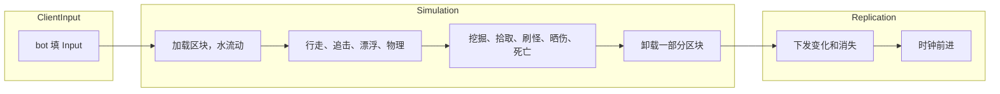

import { Boxes, FlaskConical, Network, Save } from 'lucide-react';

一个仿 Minecraft 服务器的方块世界：每秒 20 tick，玩家周围按需生成区块，走远了就释放；泉眼的水往低处流，站在水里的人会被冲走；
挖下的方块变成掉落物；僵尸夜里出现，天亮就烧死；只把变了的东西发给客户端；服务器停机时存档。50 个 bot 玩一分钟游戏时间。
本页所有代码都直接引用自
[`samples/VoxelServer`](https://github.com/JasonXuDeveloper/EasyEcs/tree/master/samples/VoxelServer)。CI 会构建并运行它，
拿输出和下面的结果逐行比对。

它写的是服务器，但里面没有一处只属于服务器：同一个 World 也能放在客户端。客户端跑同样的区块、水和刚体，在服务器的包到达之前先预测；
每个 tick 之后，渲染层读位置和方块画出来。服务器算世界、下发变化，客户端负责显示。见[客户端与服务器](#client-and-server)。

## 你会学到 [#what-you-learn]

下面每种技巧各占一节，配上用到它的代码。

- **一个 tick 分三组**：输入、模拟、下发各是一个[系统组](/zh/docs/guide/systems#system-groups)，各自由
  `world.Update<TGroup>()` 运行（[一个 tick](#one-tick)）。
- **区块是实体，方块是缓冲**：[唯一索引](/zh/docs/guide/indexes-and-relations#unique-keys)按坐标找到区块，一个枚举的
  [动态缓冲](/zh/docs/guide/dynamic-buffers)存它的 8,192 个方块（[区块](#chunks)）。
- **频率与分片**：每秒加载两次区块（[`UpdateInterval`](/zh/docs/guide/systems#update-interval)），卸载和僵尸张望每 tick
  只处理二十分之一或十分之一（[`Slices`](/zh/docs/guide/systems#slices)），遍历途中直接做[结构变更](/zh/docs/guide/structural-changes)。
- **视野（AOI）**：每个[预制体](/zh/docs/guide/prefabs)一个 `Vision`，每个区块记下有几个玩家看得到它，再用按区块分组的玩家
  [值索引](/zh/docs/guide/indexes-and-relations#value-indexes)当网格（[视野](#aoi)）。
- **水也是数据**：每格水一个实体，是所在区块的子实体（[层级](/zh/docs/guide/hierarchy)）；只有还要扩散的水才带 `Flowing`
  组件（[水](#water)）。
- **过滤条件**：`[With<Humanoid>]` 挑出会漂的，`[With<Zombie>]` 挑出会晒伤的（[过滤条件](/zh/docs/guide/queries#filters)）。
- **行彼此独立就上多线程**：只碰自己那一行的系统用 [`[ForEach(Parallel = true)]`](/zh/docs/guide/systems#parallel-methods)
  （[移动](#movement)）。
- **数据成列才用 SIMD**：一个[批量方法](/zh/docs/guide/systems#batch-methods)一条指令给 8 只僵尸各扣一点血（[SIMD](#simd)）。
- **自动排好序的排行榜**：按挖掘数给玩家建[有序索引](/zh/docs/guide/indexes-and-relations#ordered-index)（[排行榜](#leaderboard)）。
- **只发变了的**：[`[Changed<T>]` 和 `Mut<T>`](/zh/docs/guide/change-tracking)，血条用 [`Maybe<T>`](/zh/docs/guide/systems#maybe)，
  消失的实体用[销毁日志](/zh/docs/guide/change-tracking#destroy-log)（[下发](#replication)）。
- **停机存档**：[`SaveWithout` 和 `LoadKeeping`](/zh/docs/guide/saves#restart)，预制体每次启动重新建。
- **量出来**：[`MeasureSystems` 和 `DescribeSchedule`](/zh/docs/guide/diagnostics)。

## 运行 [#run-it]

```bash
dotnet run -c Release --project samples/VoxelServer                      # 50 bots, one minute of game time
dotnet run -c Release --project samples/VoxelServer -- --players 5000    # a crowd
dotnet run -c Release --project samples/VoxelServer -- --realtime        # 20 ticks a second, like a vanilla server
dotnet run -c Release --project samples/VoxelServer -- --schedule        # the order the systems run in
```

## 一个 tick：三个组 [#one-tick]



一个 tick 分三部分，每部分是一个系统组：一个给它命名的 struct，加上系统上的 `[UpdateInGroup<T>]`。

<include lang="csharp" meta='title="Groups.cs"'>../../../samples/VoxelServer/Groups.cs</include>

宿主按顺序运行这三个组，每组单独 update。真正的服务器可以在包到达时就跑 `ClientInput`，给远处的玩家用更低的频率跑
`Replication`，一个系统都不用改。

<include lang="csharp" meta='title="Host/Server.cs"'>../../../samples/VoxelServer/Host/Server.cs#tick</include>

组内的系统按添加顺序运行。系统之间互不调用：各自读写组件，后一个看到前一个写下的结果。

<include lang="csharp" meta='title="Program.cs"'>../../../samples/VoxelServer/Program.cs#systems</include>

## 数据 [#data]

先是方块、区块和水，再是会动的东西，最后是单例。注释写明每个值的含义和由谁来写。

<include lang="csharp" meta='title="Components.cs"'>../../../samples/VoxelServer/Components.cs</include>

规则是常量加几个纯函数；地形负责方块的位置和区块的生成。系统读方块只走 `BlockAt` 这一个入口，所以没加载的区块处处读成石头。

<include lang="csharp" meta='title="Rules.cs"'>../../../samples/VoxelServer/Rules.cs</include>

<include lang="csharp" meta='title="Terrain.cs"'>../../../samples/VoxelServer/Terrain.cs</include>

## 玩家周围的区块 [#chunks]

`ChunkLoadSystem` 遍历每个玩家视野里的区块：缺的补上，并在每个区块上数清有几个玩家看得到它（`Viewers`）。`world.ChunkIndex`
是 `Chunk` 的唯一索引，查找就是一次哈希探测；方块用一次 `AddRange` 写进区块的缓冲。每秒两次就够（`UpdateInterval`）：玩家每秒走四格，
视野往前看两个区块。

<include lang="csharp" meta='title="Systems/Chunks.cs"'>../../../samples/VoxelServer/Systems/Chunks.cs#load</include>

`ChunkUnloadSystem` 销毁五秒没人看到的区块。`Slices = 20` 让每个 tick 只检查二十分之一：1,300 个区块每 tick 查 65 个，
而不是每秒一次查完 1,300 个。在遍历途中销毁没问题，还会连带销毁它的水，因为每格水都是它的子实体。

<include lang="csharp" meta='title="Systems/Chunks.cs"'>../../../samples/VoxelServer/Systems/Chunks.cs#unload</include>

## 视野（AOI） [#aoi]

和 Minecraft 服务器一样，玩家看得到什么，决定了服务器为它做什么：周围哪些区块保持加载、哪些变化要发给它。僵尸看得到什么，
决定了它追谁。视野范围是数据：每个预制体设一个 `Vision`，玩家 32 格，僵尸 16 格。想要一个看得更远的 Boss，多一个预制体就行，
不用写新代码。

<include lang="csharp" meta='title="Program.cs"'>../../../samples/VoxelServer/Program.cs#prefabs</include>

视野有两面，每一面都是一份数据，由一个系统维护、其他系统读取：

- **谁收到什么**。上面的加载会在每个区块上留下看得到它的玩家数，以及数的那个 tick。`Rules.Watching` 把它换算成区块里一次变化要发给几个玩家；
  上次加载时没人看到，就是零。挖掉一块、走一步、水漫过来，都只发给这么多玩家，人群挤在一处，远处的玩家不受影响（见[下发什么](#replication)）。
- **谁看得到谁**。一张网格：`InChunk` 是带索引的组件，记玩家站在哪个区块，所以 `world.InChunkIndex.Find(chunk)` 列出一个区块里的玩家。
  `GridSystem` 让它保持最新，只在玩家跨进另一个区块时才写（`SetInChunkIfChanged`），所以索引每秒只变几次，而不是每 tick 都变。

<include lang="csharp" meta='title="Systems/Movement.cs"'>../../../samples/VoxelServer/Systems/Movement.cs#grid</include>

`ZombieSightSystem` 读这张网格：对 `Vision` 覆盖的每个区块，遍历里面的玩家，用距离的平方比较，留下范围内最近的那个。
一只僵尸只看几十个玩家而不是全部；每个 tick 只有十分之一的僵尸去看（`Slices`），所以一大群僵尸每 tick 的开销都一样，
不会每秒冒两次尖峰。

<include lang="csharp" meta='title="Systems/Zombies.cs"'>../../../samples/VoxelServer/Systems/Zombies.cs#sight</include>

“谁在谁附近”在 ECS 里的常规做法就是这种网格：一张从格子到格子里实体的索引，由移动它们的系统维护，需要邻居的系统来读。
这里的格子是区块，因为区块本来就是加载的单位；人群更密的游戏用更小的格子，代码一样。

## 水 [#water]

一格水出现五个 tick 后扩散一次：下面是空气就往下流，否则往四周流，离泉眼远一级，平地上最多流七格。扩散完 `Flowing` 就去掉，
方法参数带 `in Flowing` 的 `WaterFlowSystem` 再也不会访问它：静止的湖不花一点开销。

<include lang="csharp" meta='title="Systems/Water.cs"'>../../../samples/VoxelServer/Systems/Water.cs#flow</include>

`FloatSystem` 带过滤条件 `[With<Humanoid>]`：玩家和僵尸有这个标签，掉落物没有，会沉下去。过滤条件是查询的一部分，
掉落物根本不会被访问，方法也不用接一个从来不读的标签。它用唯一索引 `world.WaterIndex` 找到人形生物脚下的水，把它推离泉眼，
离得越近推得越猛。

<include lang="csharp" meta='title="Systems/Water.cs"'>../../../samples/VoxelServer/Systems/Water.cs#float</include>

## 移动 [#movement]

行走把输入变成速度。每一行只依赖它自己，方法里也不持有 `World`，所以是并行方法：它的行分到多个线程上跑，每次结果都一样。

<include lang="csharp" meta='title="Systems/Movement.cs"'>../../../samples/VoxelServer/Systems/Movement.cs#walk</include>

物理让每个刚体在方块间移动，通过 `Mut<Position>` 写位置：`SetIfChanged` 只在位置变了时才给这一行打 tick，所以站着不动的刚体不会下发。
它留在单线程上，因为它通过 `World`（区块索引）读方块，而并行方法不能持有 World（EECS010）。`FloatSystem` 和
`ZombieSightSystem` 也一样。

<include lang="csharp" meta='title="Systems/Movement.cs"'>../../../samples/VoxelServer/Systems/Movement.cs#physics</include>

## 挖掘与掉落物 [#items]

挖一下，方块变成空气和一个掉落物，挖的人 `Score` 加一（见[排行榜](#leaderboard)）；洞旁边的水重新开始流（重新带上 `Flowing`）。
缓冲用 `chunk.Block[slot]` 读、用 `chunk.WriteBlock()` 写，所以只有挖掘才会给区块打 tick。

<include lang="csharp" meta='title="Systems/Items.cs"'>../../../samples/VoxelServer/Systems/Items.cs#dig</include>

掉落物用 `EntityId` 记住它的主人。主人走近时，背包（一个 `DynamicBuffer<ItemStack>`）里同类的那一叠加一，没有就新开一叠；
没人捡的掉落物到时消失。

<include lang="csharp" meta='title="Systems/Items.cs"'>../../../samples/VoxelServer/Systems/Items.cs#pickup</include>

<include lang="csharp" meta='title="Systems/Items.cs"'>../../../samples/VoxelServer/Systems/Items.cs#expiry</include>

## 僵尸与死亡 [#zombies]

夜里每隔几秒，每个玩家附近冒出一只僵尸：僵尸预制体的一个实例，带自己的 `Position`。僵尸追它看到的玩家；目标玩家离开后，
旧 id 上的 `TryGetEntity` 会失败，僵尸就知道了。

<include lang="csharp" meta='title="Systems/Zombies.cs"'>../../../samples/VoxelServer/Systems/Zombies.cs#spawn</include>

<include lang="csharp" meta='title="Systems/Zombies.cs"'>../../../samples/VoxelServer/Systems/Zombies.cs#chase</include>

死亡就是 `Health` 归零，每种实体一个系统处理：僵尸消失，玩家清空背包后重生。

<include lang="csharp" meta='title="Systems/Health.cs"'>../../../samples/VoxelServer/Systems/Health.cs</include>

## 数据成列才用 SIMD [#simd]

白天每个 tick，晒伤给每只僵尸扣一点血。批量方法拿到的是一段连续行的 span，所以一段僵尸的血量就是一个 `Span<Health>`，
也就是一个 `int` 的 span。`Vector<int>` 在 AVX2 上一条指令给 8 只扣血（Arm 上 4 只）。JIT 不会自己把循环向量化，所以方法自己来；
整数通道在每台机器上结果都一样。

<include lang="csharp" meta='title="Systems/Zombies.cs"'>../../../samples/VoxelServer/Systems/Zombies.cs#sunburn</include>

SIMD 只在同一种算术跑过一整列时才划算，而这个服务器里这种情况很少。其他系统对每个实体做的事都不一样：物理要查每个刚体周围的方块，
水和视野要查索引，追击要读另一个实体的位置。查找加分支的循环，向量帮不上忙；位置又是 `Vector3`，三个 float 挨在一起，而不是三列。
批量方法还只在一个线程上跑（EECS010），所以提速靠的是向量循环，不是多线程。

## 自动排好序的排行榜 [#leaderboard]

`Score` 是玩家挖掉的方块数，是一个 `IIndexed<int>`（见[数据](#data)），所以 `world.ScoreIndex` 是按分数排的玩家索引。
它的键可以比较，所以索引能按顺序遍历：`Descending()` 从挖得最多的人开始。`DigSystem` 写分数时索引一直保持有序，
所以榜首只是走三个条目，从不需要给所有玩家排序。

<include lang="csharp" meta='title="Program.cs"'>../../../samples/VoxelServer/Program.cs#leaderboard</include>

同一个索引上的 `Range(from, to)` 列出两个分数之间的玩家，用来翻排行榜的一页。

## 下发什么 [#replication]

变了的区块来自缓冲上的 `[Changed<T>]`：没人挖、没被水淹的区块不会被访问。每次变化发给当时视野里有这个区块的玩家（`Rules.Watching`）。

<include lang="csharp" meta='title="Systems/Replication.cs"'>../../../samples/VoxelServer/Systems/Replication.cs#chunks</include>

动了的实体来自 `[Changed<Position>]`，由上面的 `Mut<Position>` 打 tick。有血条的实体在更新里带上血条：`Maybe<Health>`
只在实体有 `Health` 时读它，所以玩家、僵尸和掉落物由一个方法下发，查询也不要求 `Health`。

<include lang="csharp" meta='title="Systems/Replication.cs"'>../../../samples/VoxelServer/Systems/Replication.cs#entities</include>

被销毁的实体已经没有行了：消失的实体来自销毁日志，从这个系统上次运行的 tick 算起。时钟最后前进。

<include lang="csharp" meta='title="Systems/Replication.cs"'>../../../samples/VoxelServer/Systems/Replication.cs#despawns</include>

<include lang="csharp" meta='title="Systems/Replication.cs"'>../../../samples/VoxelServer/Systems/Replication.cs#clock</include>

## 程序 [#program]

World 和它的选项：销毁日志给消失的实体用，`MeasureSystems` 用来计时，缓冲池放得下一个区块的方块，所以新加载的区块会复用已卸载区块的列表。

<include lang="csharp" meta='title="Program.cs"'>../../../samples/VoxelServer/Program.cs#options</include>

玩家是玩家预制体的实例，带自己的客户端、位置和区块。tick 循环和 bot 在
[`Host/`](https://github.com/JasonXuDeveloper/EasyEcs/tree/master/samples/VoxelServer/Host) 里：那是搭架子的代码，不是这一课的内容。

<include lang="csharp" meta='title="Program.cs"'>../../../samples/VoxelServer/Program.cs#players</include>

停机时存档不带预制体，因为每次启动都会重建；重启的 World 先建预制体，再把存档加载进来。

<include lang="csharp" meta='title="Program.cs"'>../../../samples/VoxelServer/Program.cs#save</include>

## 输出 [#output]

```text
tick   200 (day  ): 50 players, 82 chunks, 1961 water, 0 zombies, 0 items
tick   400 (night): 50 players, 119 chunks, 3070 water, 50 zombies, 0 items
tick   600 (day  ): 50 players, 135 chunks, 4322 water, 150 zombies, 0 items
tick   800 (day  ): 50 players, 142 chunks, 4054 water, 0 zombies, 0 items
tick  1000 (night): 50 players, 171 chunks, 5311 water, 50 zombies, 0 items
tick  1200 (day  ): 50 players, 170 chunks, 4774 water, 150 zombies, 0 items
chunks: 232 loaded, 62 unloaded, 25227 sent
blocks dug: 638; items: 638 picked up, 0 expired
zombies: 300 spawned, 150 burned, 361 hits; player deaths: 39
water: 7625 cells poured, 5005 ticks of humanoids carried
sent: 1640729 entity updates (28840 KiB), 3701 despawns
top diggers: player 6 (22) player 24 (21) player 22 (21)
restarted from the save: 50 players, 170 chunks, 4774 water, 150 zombies
```

世界、泉眼、bot 和刷怪都由整数哈希决定，所以单线程还是多线程，每次输出都一样。bot 往外走，区块就多起来，走过的区块又被释放，
水跟着一起增减；每晚每个玩家身边冒出三只僵尸，天亮一秒后全部烧光。耗时写到 stderr：平均每 tick 用了 50 ms 预算的多少，
以及每个系统的耗时和分配。

## 没用到的功能，以及原因 [#not-used]

- **按区块 `GroupBy`**。按区块拆表能让“一个区块里的实体”在内存里连续，但玩家每跨一次区块，它的行就要搬到另一张表，
  每个走动的玩家每秒都要搬好几次。`InChunk` 索引在跨区块时只更新一次索引，别的什么都不花。
- **用清理组件在卸载时保存区块**。退休的实体会失去其他组件，方块缓冲也在其中，到那时已经没东西可存了。要保留已卸载区块的服务器，
  应该在 `ChunkUnloadSystem` 里 `Destroy` 之前保存。
- **`[ChangedAny<Position, Health>]`**。要连血量变化一起下发，`Health` 就得被追踪；而晒伤以 span 写每只僵尸的血量，白天每个 tick
  都会给整段打 tick：无论如何，整群僵尸每 tick 都会被下发。
- **并行的物理、水和视野**。它们通过 World 的索引读数据，见[移动](#movement)。

## 客户端与服务器 [#client-and-server]

联网游戏通常这样分工：服务器掌握世界、下发变化，客户端负责显示。两边都可以用这套 ECS：

- **服务器上**，就像这个示例：系统每个 tick 计算世界，`Send` 系统把变化（`[Changed<T>]`、销毁日志）编成包。
- **客户端上**，收到的包写进一个组件相同的 World。同样的 `PhysicsSystem` 和 `FloatSystem` 在两个包之间预测本地玩家，
  渲染系统读 `Position` 和区块的方块来画：在 [Godot](/zh/docs/samples/godot) 里，节点在 `_PhysicsProcess` 中
  `World.Update()` 之后立刻绘制。

两边都要用的组件和系统放进一个共享项目，就像 [HotReload 示例](/zh/docs/samples/hot-reload)里的 Contracts。

## 相关页面 [#related]

<Cards>
  <Card icon={<Boxes />} title="动态缓冲" href="/zh/docs/guide/dynamic-buffers">
    每个实体一个列表，比如区块的方块，和普通组件一样被追踪。
  </Card>
  <Card icon={<FlaskConical />} title="变更追踪" href="/zh/docs/guide/change-tracking">
    什么算写入、Mut&lt;T&gt;、销毁日志。
  </Card>
  <Card icon={<Network />} title="示例：战斗服务器" href="/zh/docs/example">
    一个服务器用上所有功能，客户端可以断线追赶。
  </Card>
  <Card icon={<Save />} title="存档" href="/zh/docs/guide/saves">
    存下 World、从存档重启、跳过每次启动自己设置的部分。
  </Card>
</Cards>
