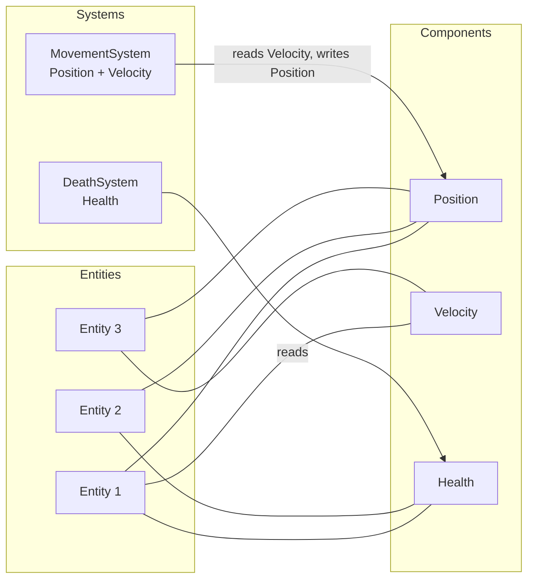
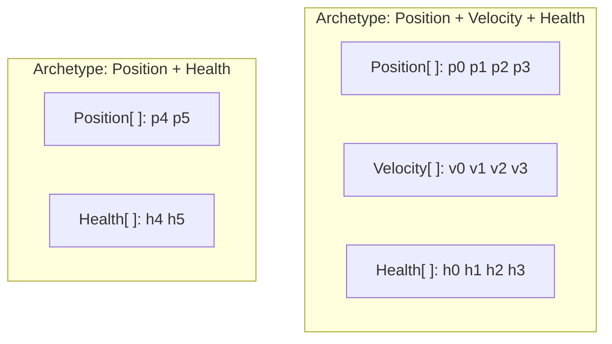

An **Entity Component System (ECS)** is a way to structure a program around its data. An **entity** is an id, a
**component** is a piece of plain data attached to an entity, and a **system** is logic that runs over every entity
that has a given set of components. Behaviour comes from which components an entity has, not from which class it is
an instance of.

The pattern comes from game development, where a world holds thousands of things that share some traits and differ
in others, and every one of them must be updated many times a second. It fits any program with the same shape:
game servers, simulations, digital twins, agent models.

In C# and .NET an ECS comes as a library. EasyEcs, Friflo.Engine.ECS, Arch and DefaultEcs are .NET libraries (the
last three also run in Unity); Unity Entities (DOTS) is Unity's own. EasyEcs is an allocation-free archetype ECS for
.NET 10 game servers and simulations: systems are `[ForEach]` methods that a source generator compiles into struct
jobs, and a server tick of 100,000 entities takes <BenchValue k="tick.oneWorld" /> and allocates
<BenchValue k="tick.oneWorld.alloc" />.

<BenchSource />

## The three parts [#the-three-parts]



<Tabs items={['Entity', 'Component', 'System']}>
<Tab value="Entity">

An **entity** is an identity and nothing else: no fields, no methods. In EasyEcs it is a small handle (world, id,
version). Ids are recycled, and the version tells a live entity from a destroyed one that used the same id, so a
stale handle never reaches the wrong entity.

```csharp
Entity unit = world.CreateEntity(new Position(0, 0), new Health(100));
```

</Tab>
<Tab value="Component">

A **component** is plain data: a struct with fields and no behaviour. An empty struct is a **tag**, a yes-or-no
state such as `Dead` or `Stunned`. Data that exists once per world (the clock, the map) is a **singleton**.

```csharp
public record struct Position(float X, float Y) : IComponent;
public record struct Health(int Value) : IComponent;
public struct Dead : IComponent;                                // a tag
public record struct Clock(float Dt) : ISingletonComponent;     // one per world
```

</Tab>
<Tab value="System">

A **system** is the logic. It names the components it reads and writes, and the ECS runs it over every entity that
has them. Systems do not call each other: they cooperate through the data they write.

```csharp
public class MovementSystem : EcsSystem
{
    [ForEach, Without<Dead>]
    static void Move(ref Position p, in Velocity v, in Clock clock)
    {
        p.X += v.X * clock.Dt;
        p.Y += v.Y * clock.Dt;
    }
}
```

</Tab>
</Tabs>

A **query** is the question a system asks: "every entity with `Position` and `Velocity` but without `Dead`". The
answer changes as entities gain and lose components, which is how an entity changes behaviour: add `Velocity` and it
starts moving, add `Dead` and every system that excludes `Dead` stops seeing it.

## How an ECS stores components [#storage]

The way components are laid out in memory decides what is fast. There are two common designs.

### Archetypes [#archetypes]

An **archetype** is one combination of component types. Every entity with exactly `Position + Velocity + Health`
lives in the same table, one row per entity and one column per component (a structure of arrays). A query finds the
tables whose combination includes what it asks for and walks their columns front to back.



- **Iteration is linear.** The columns a system touches are contiguous arrays, which is what CPU prefetchers and
  SIMD handle best. There is no per-entity lookup.
- **Changing an entity's set of components moves it** to another table: its row is copied column by column. Designs
  differ in how much this costs and when it happens: many libraries defer it to a command buffer applied later.

Unity Entities, Bevy (by default), Flecs, Arch, Friflo.Engine.ECS and EasyEcs are archetype ECSs.

### Sparse sets [#sparse-sets]

A **sparse set** stores each component type on its own: a dense array of values, plus an index from entity id to
position in that array. Adding or removing a component touches only that component's set; nothing else moves.

- **Adding and removing are cheap**, and every component type is independent.
- **Queries over several components** walk one set and look the entity up in the others, which is random access
  rather than a linear walk.

EnTT and DefaultEcs store components this way; Bevy offers it per component type as an option.

### The trade-off [#trade-off]

| | Archetypes | Sparse sets |
| --- | --- | --- |
| Iterating several components together | Linear walk over contiguous columns | One set walked, the others looked up per entity |
| Adding or removing a component | The entity's row moves to another table | Only that component's set changes |
| Memory per entity | One row per table, no per-type index | An index entry per component type |
| Best when | Many entities share combinations and are updated every tick | Components come and go constantly, queries are narrow |

EasyEcs is an archetype ECS that removes the usual cost of the archetype design for states that come and go:
removing a component keeps the row and clears a presence bit, so toggling a status such as `Stunned` never moves
data after the first time. The details are in [Architecture](/en/docs/architecture#storage-model).

## How does an entity change what it does? [#structural-changes]

By gaining and losing components. Adding, removing, creating and destroying are **structural changes**: they change
which tables an entity lives in, or which entities exist. The hard case is a change made while a system is iterating
over the very tables it changes, such as a death system that marks units `Dead` as it walks them.

Most ECS libraries forbid that and give you a **command buffer**: the system records "add `Dead` to entity 42", and
the buffer plays the changes back after the loop. It works, but systems then see a state that is about to change,
and the order of effects depends on when buffers are played back.

EasyEcs applies every structural change at once, even in the middle of a pass. A pass still visits each entity at
most once, entities that join a table during the pass wait for the next one, and the systems that run later in the
same update see the change. See [Structural changes](/en/docs/guide/structural-changes).

## Can an ECS run systems in parallel? [#parallel]

Yes, and this is one of its strengths. A system declares what it reads and what it writes; two systems that write
nothing the other touches can run at the same time without locks. In EasyEcs the declaration is the method itself:
`ref Position` is a write, `in Velocity` a read, and the generator turns those into the access the scheduler uses
(`WorldOptions.ParallelSystems`). One heavy system can also split its rows across cores with
`[ForEach(Parallel = true)]`.

For a server, the simplest parallelism is often one world per thread, such as one per map or zone: worlds share
nothing, so they need no synchronization at all. See [Threading](/en/docs/guide/threading).

## Is an ECS faster than object-oriented code? [#ecs-vs-oop]

For the work an ECS is built for, usually yes, for two reasons: memory layout and the absence of virtual dispatch.

In typical object-oriented code, each game object is a class instance on the heap with its fields together, and its
behaviour is a virtual `Update()` method. Updating 100,000 of them means following 100,000 references to scattered
objects and making 100,000 virtual calls, each of which drags the whole object through the cache to read two fields.
In an ECS, the movement system reads exactly two arrays, `Position` and `Velocity`, in order, and the loop body can
be inlined. In EasyEcs, a `[ForEach]` system that adds `Velocity` to `Position` costs
<BenchValue k="forEach.perEntity" /> per entity, against <BenchValue k="rawArray.perEntity" /> for the same update
written by hand over two plain arrays.

<BenchSource />

The difference in how you design is just as large:

| | Object-oriented | ECS |
| --- | --- | --- |
| A kind of thing | A class, often in an inheritance hierarchy | A combination of components |
| Behaviour | Methods on the object | Systems over every matching entity |
| Changing what something does | Change its class, or add flags and branches | Add or remove a component |
| Shared state | Objects reference each other | Systems read and write components; singletons hold world state |
| Memory | An object per thing, wherever the heap put it | A column per component, contiguous |

Neither is better everywhere. Object-oriented code is a fine fit for a few long-lived objects with rich, distinct
behaviour, such as services, UI and business workflows, and an ECS gains little there.

## When should you use an ECS? [#when-to-use]

<Callout type="idea" title="An ECS fits when">
  - Many entities (thousands to millions) share behaviour in different combinations.
  - The world is updated in ticks, and most of the time goes into loops over those entities.
  - Things change what they are at run time: a unit is stunned, burning, dead, then respawned.
  - You want each piece of logic isolated, so it can be tested, reordered or run in parallel on its own.
</Callout>

<Callout type="warn" title="It is the wrong tool when">
  - There are a few dozen objects with very different behaviour.
  - The work is request and response over a database, with no per-tick simulation.
  - The data is deeply nested documents rather than flat, uniform records.
</Callout>

Typical ECS workloads are game servers (zones, matches, MMO maps), real-time strategy and simulation games, physics
and crowd simulations, robotics and traffic models, and digital twins.

## Is an ECS only for games? [#beyond-games]

No. Games made the pattern popular because their worlds are large, uniform and updated every frame, but nothing in
it is specific to games. Any program that simulates many similar things over time, such as a traffic model, an
epidemic simulation, a market simulation or a fleet of IoT devices, has the same shape and benefits the same way.

## Isn't this just composition over inheritance? [#composition]

It starts there. "Composition over inheritance" builds an object from parts instead of a class hierarchy, and an ECS
does the same with components. The difference is where the behaviour lives: composed objects still carry their
methods and call each other, while an ECS moves all behaviour into systems that run over every entity with the right
parts. That is what makes the data contiguous and each system independent.

## Which ECS libraries are there for C# and .NET? [#csharp-libraries]

| Library | Storage | Runs on |
| --- | --- | --- |
| EasyEcs | Archetypes, presence bits per column | .NET 10 (servers, tools, tests) |
| Friflo.Engine.ECS | Archetypes | .NET and Unity |
| Arch | Archetypes in chunks | .NET and Unity |
| DefaultEcs | A pool per component type | .NET and Unity |
| Unity Entities (DOTS) | Archetypes in chunks | Unity only |

On the same server tick of 100,000 entities, Friflo.Engine.ECS takes <BenchValue k="peers.friflo.ratio" /> the time
of EasyEcs, Arch <BenchValue k="peers.arch.ratio" /> and DefaultEcs <BenchValue k="peers.defaultecs.ratio" />, and only
EasyEcs and Friflo allocate nothing per tick.
How EasyEcs measures against the other .NET libraries on the same server tick, feature by feature, is in
[Comparison](/en/docs/comparison).

## What does EasyEcs add? [#easyecs]

EasyEcs is an archetype ECS for C# and .NET 10 servers. On top of the pattern above it gives you:

- **Systems written as methods.** A `[ForEach]` method is the whole system; a source generator turns it into an
  inlined struct job, and filters are attributes.
- **Immediate structural changes.** Add, remove, create and destroy in the middle of a pass, with no command buffer.
- **No garbage per tick.** After warm-up, updates, queries and structural changes allocate nothing; a full server
  tick of 100,000 entities takes <BenchValue k="tick.oneWorld" />.
- **Design rules checked at compile time.** The analyzer rejects stateful systems, systems that call each other and
  writes through `in`.
- **The rest of a server's needs built in:** change and removal tracking, value indexes, relations and a hierarchy,
  prefabs, dynamic buffers, snapshots, saves and moving entities between worlds ([Features](/en/docs/features)).

The words used on this page and the rest of the docs are defined in the [Glossary](/en/docs/glossary).

<Cards>
  <Card title="Getting started" href="/en/docs/getting-started">
    Build a small simulation step by step.
  </Card>
  <Card title="ECS principles" href="/en/docs/ecs-principles">
    How to design features as data plus one-job systems.
  </Card>
  <Card title="Features" href="/en/docs/features">
    Every feature, what it is for and what it costs.
  </Card>
  <Card title="Comparison" href="/en/docs/comparison">
    EasyEcs next to Friflo.Engine.ECS, Arch and DefaultEcs.
  </Card>
</Cards>
