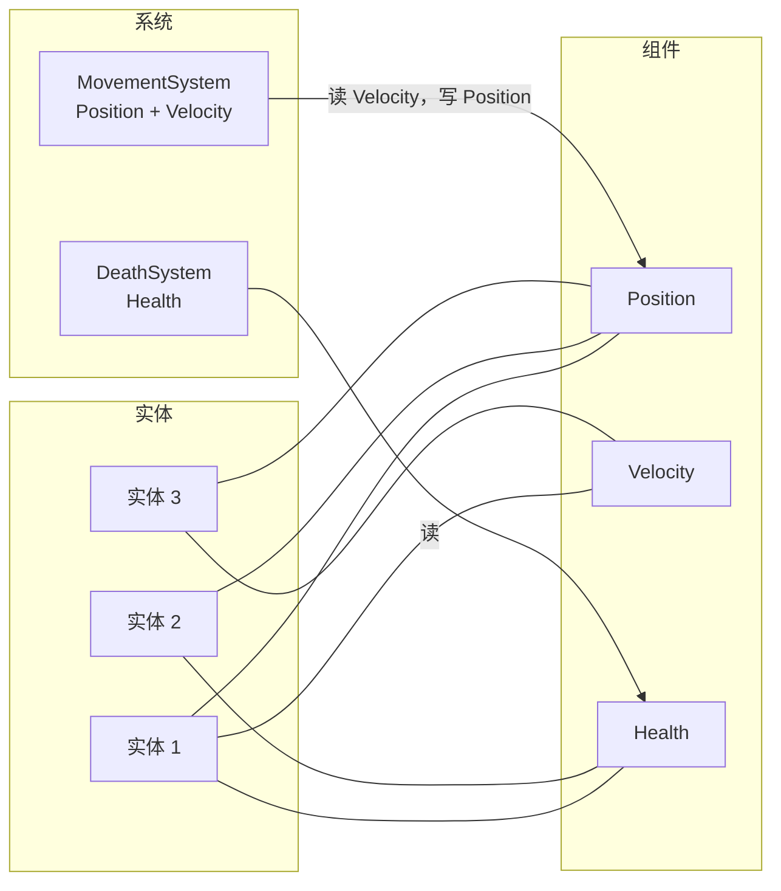
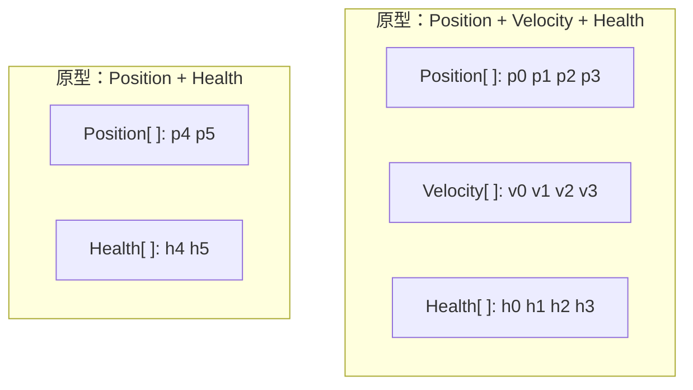

**实体组件系统（Entity Component System，ECS）**是一种围绕数据来组织程序的方式。**实体**只是一个 id，
**组件**是挂在实体上的一份纯数据，**系统**是一段逻辑，对拥有某组组件的所有实体统一执行。一个实体能做什么，
取决于它身上有哪些组件，而不是它属于哪个类。

这个模式来自游戏开发：一个世界里有成千上万个对象，彼此有共性也有差异，每秒还要更新很多次。凡是形态相同的程序都适用：
游戏服务器、各类模拟、数字孪生、智能体模型。

在 C# 和 .NET 里，ECS 以库的形式出现。EasyEcs、Friflo.Engine.ECS、Arch 和 DefaultEcs 都是 .NET 库（后三个也能在
Unity 里用），Unity Entities（DOTS）是 Unity 自带的。EasyEcs 是面向 .NET 10 游戏服务器与模拟的零分配原型（archetype）
ECS：系统就是 `[ForEach]` 方法，由源生成器编译成结构体 job；10 万实体的服务器 tick 耗时
<BenchValue k="tick.oneWorld" />，分配 <BenchValue k="tick.oneWorld.alloc" />。

<BenchSource />

## 三个组成部分 [#the-three-parts]



<Tabs items={['实体', '组件', '系统']}>
<Tab value="实体">

**实体**只是一个身份，没有字段，也没有方法。在 EasyEcs 里它是一个很小的句柄（World、id、版本号）。id 会被回收复用，
版本号用来区分活着的实体和用过同一个 id 的已销毁实体，所以过期的句柄永远不会碰到别的实体。

```csharp
Entity unit = world.CreateEntity(new Position(0, 0), new Health(100));
```

</Tab>
<Tab value="组件">

**组件**是纯数据：只有字段、没有行为的结构体。空结构体就是**标签**，表示“是或否”的状态，比如 `Dead`、`Stunned`。
整个 World 只有一份的数据（时钟、地图）是**单例**。

```csharp
public record struct Position(float X, float Y) : IComponent;
public record struct Health(int Value) : IComponent;
public struct Dead : IComponent;                                // 标签
public record struct Clock(float Dt) : ISingletonComponent;     // 每个 World 一份
```

</Tab>
<Tab value="系统">

**系统**就是逻辑。它声明自己读哪些组件、写哪些组件，ECS 会对所有拥有这些组件的实体执行它。系统之间不互相调用，
只通过写入的数据协作。

```csharp
public class MovementSystem : EcsSystem
{
    [ForEach, Without<Dead>]
    static void Move(ref Position p, in Velocity v, in Clock clock)
    {
        p.X += v.X * clock.Dt;
        p.Y += v.Y * clock.Dt;
    }
}
```

</Tab>
</Tabs>

**查询**就是系统提出的问题：“所有有 `Position` 和 `Velocity`、但没有 `Dead` 的实体”。实体增减组件时，答案随之变化，
实体的行为也就跟着变了：加上 `Velocity` 它就开始移动，加上 `Dead`，所有排除 `Dead` 的系统就再也看不到它。

## ECS 怎么存储组件 [#storage]

组件在内存里怎么排布，决定了什么操作快、什么操作慢。常见的设计有两种。

### 原型（archetype） [#archetypes]

**原型（archetype）**指的是一种组件组合。所有恰好拥有 `Position + Velocity + Health` 的实体放在同一张表里：每个实体一行，
每种组件一列（也就是 SoA，数组结构）。查询先找出组合包含所需组件的那些表，再把它们的列从头到尾扫一遍。



- **遍历是线性的。** 系统用到的列都是连续数组，正好是 CPU 预取和 SIMD 最擅长的形态，也不需要逐个实体查表。
- **实体的组件组合一变，就要搬家**到另一张表，整行数据逐列拷贝过去。各家库的区别在于这一步有多贵、在什么时候发生：
  很多库会把它推迟到命令缓冲（command buffer）里，之后统一执行。

Unity Entities、Bevy（默认存储）、Flecs、Arch、Friflo.Engine.ECS 和 EasyEcs 都是 archetype ECS。

### 稀疏集（sparse set） [#sparse-sets]

**稀疏集**把每种组件单独存放：一个紧凑的值数组，加上一张从实体 id 到数组下标的索引。增删组件只影响这一种组件的集合，
其他数据都不用动。

- **增删组件很便宜**，各组件类型互不影响。
- **同时查询多种组件**时，要遍历其中一个集合，再到其他集合里逐个查实体，这是随机访问，不是线性扫描。

EnTT 和 DefaultEcs 用的是这种存储；Bevy 也允许按组件类型选用稀疏集。

### 怎么取舍 [#trade-off]

| | 原型 | 稀疏集 |
| --- | --- | --- |
| 同时遍历多种组件 | 线性扫描连续的列 | 遍历一个集合，其余逐个实体查找 |
| 增删一个组件 | 实体那一行搬到另一张表 | 只改动这种组件的集合 |
| 每个实体的内存 | 每张表一行，不需要按类型建索引 | 每种组件一条索引 |
| 适合 | 大量实体共享组合、每个 tick 都要更新 | 组件频繁增删、查询范围很窄 |

EasyEcs 是 archetype ECS，但去掉了这种设计在“来来去去的状态”上的常见开销：移除组件时保留这一行，只清掉一个存在位，
所以像 `Stunned` 这样反复开关的状态，除了第一次，之后都不会再搬数据。细节见[架构](/zh/docs/architecture#storage-model)。

## 实体怎么改变自己的行为？ [#structural-changes]

靠增删组件。增删组件、创建和销毁实体都属于**结构变更**：实体换到哪张表、World 里有哪些实体，都会随之改变。难点在于系统一边遍历
一张表、一边修改这张表，比如死亡系统一边扫描单位、一边给它们打上 `Dead`。

大多数 ECS 库禁止这样做，转而提供**命令缓冲（command buffer）**：系统先记下“给 42 号实体加上 `Dead`”，循环结束后再统一回放。
这样能用，但系统看到的是一个马上就要变的状态，效果的先后也取决于缓冲什么时候回放。

EasyEcs 的结构变更立即生效，遍历途中也一样。一次遍历里每个实体仍然最多访问一次，遍历途中新进表的实体留到下一次遍历，
同一次更新里排在后面的系统都能看到这次变更。详见[结构变更](/zh/docs/guide/structural-changes)。

## ECS 能并行执行系统吗？ [#parallel]

能，这正是 ECS 的长处之一。系统声明自己读什么、写什么；两个系统互不写对方用到的数据，就可以同时执行，不需要锁。EasyEcs 里，
声明就是方法签名本身：`ref Position` 是写，`in Velocity` 是读，生成器据此算出调度器需要的读写集合
（`WorldOptions.ParallelSystems`）。单个重系统还可以用 `[ForEach(Parallel = true)]` 把行分给多个核。

对服务器来说，最简单的并行往往是每个线程一个 World，比如每张地图或每个场景一个：World 之间什么都不共享，完全不需要同步。
详见[多线程与并行](/zh/docs/guide/threading)。

## ECS 比面向对象更快吗？ [#ecs-vs-oop]

在 ECS 擅长的那类工作上，通常是的，原因有两个：内存布局，以及没有虚调用。

典型的面向对象写法里，每个游戏对象是堆上的一个类实例，字段放在一起，行为写成虚方法 `Update()`。更新 10 万个对象，
就要顺着 10 万个引用去访问散落各处的对象，做 10 万次虚调用，为了读两个字段把整个对象拖进缓存。换成 ECS，移动系统只按顺序
读 `Position` 和 `Velocity` 两个数组，循环体还能被内联。在 EasyEcs 里，一个把 `Velocity` 加到 `Position` 的
`[ForEach]` 系统，每个实体耗时 <BenchValue k="forEach.perEntity" />；同样的更新手写在两个普通数组上，是
<BenchValue k="rawArray.perEntity" />。

<BenchSource />

两者在设计思路上的差别同样大：

| | 面向对象 | ECS |
| --- | --- | --- |
| 一类东西 | 一个类，常常在继承体系里 | 一种组件组合 |
| 行为 | 对象上的方法 | 作用于所有匹配实体的系统 |
| 改变一个东西能做什么 | 换类，或者加标志位和分支 | 增删一个组件 |
| 共享状态 | 对象之间互相引用 | 系统读写组件，World 级状态放在单例里 |
| 内存 | 每个东西一个对象，堆分配到哪算哪 | 每种组件一列，连续存放 |

没有哪种在所有场合都更好。对象不多、寿命长、行为差异大的场景，比如服务、UI、业务流程，用面向对象就很合适，换成 ECS 也得不到什么。

## 什么时候该用 ECS？ [#when-to-use]

<Callout type="idea" title="适合用 ECS">
  - 实体很多（成千上万到上百万），以不同的组合共享行为。
  - 世界按 tick 推进，大部分时间花在遍历这些实体的循环上。
  - 东西在运行时会改变自身状态：单位被眩晕、着火、死亡，然后复活。
  - 希望每块逻辑彼此隔离，可以单独测试、调整顺序或者并行执行。
</Callout>

<Callout type="warn" title="不适合用 ECS">
  - 只有几十个对象，行为各不相同。
  - 工作是基于数据库的请求与响应，没有逐 tick 的模拟。
  - 数据是层层嵌套的文档，而不是扁平、统一的记录。
</Callout>

典型的 ECS 场景有：游戏服务器（场景、对局、MMO 地图）、即时战略和模拟类游戏、物理与人群模拟、机器人与交通模型，以及数字孪生。

## ECS 只能用来做游戏吗？ [#beyond-games]

不是。游戏让这个模式流行起来，是因为游戏世界规模大、结构统一、每帧都要更新，但模式本身和游戏没有绑定。交通模型、疫情模拟、
市场模拟、成批的 IoT 设备，只要是随时间模拟大量相似对象的程序，形态都一样，收益也一样。

## 这不就是“组合优于继承”吗？ [#composition]

起点确实是它。“组合优于继承”用零件拼出对象，而不是靠类层次；ECS 用组件做的也是同一件事。区别在于行为放在哪里：组合出来的对象
仍然带着自己的方法，彼此互相调用；ECS 则把所有行为挪进系统，由系统处理所有零件齐全的实体。数据因此连续存放，每个系统也因此彼此独立。

## C# 和 .NET 有哪些 ECS 库？ [#csharp-libraries]

| 库 | 存储方式 | 运行环境 |
| --- | --- | --- |
| EasyEcs | 原型，每列带存在位 | .NET 10（服务端、工具、测试、Godot 4） |
| Friflo.Engine.ECS | 原型 | .NET 与 Unity |
| Arch | 分块（chunk）的原型 | .NET 与 Unity |
| DefaultEcs | 每种组件一个池 | .NET 与 Unity |
| Unity Entities（DOTS） | 分块的原型 | 仅 Unity |

与 Friflo.Engine.ECS、Arch、DefaultEcs 做的 <FeatureCount k="total" /> 项正面对比里，每个库用自己惯用的写法做同样的事，
EasyEcs 在 <FeatureCount k="ahead" /> 项更快，<FeatureCount k="even" /> 项差距在测量误差之内。在 10 万实体的完整服务器 tick
上，Friflo.Engine.ECS 的耗时是 EasyEcs 的 <BenchValue k="peers.friflo.ratio" />，Arch 是 <BenchValue k="peers.arch.ratio" />，
DefaultEcs 是 <BenchValue k="peers.defaultecs.ratio" />；每个 tick 不分配内存的只有 EasyEcs 和 Friflo。全部结果按领先幅度
排序，见[横向对比](/zh/docs/comparison#feature-by-feature)。

## EasyEcs 在此之上提供了什么？ [#easyecs]

EasyEcs 是面向 C# 与 .NET 10 服务端的 archetype ECS。在上面这些基础之上，它还提供：

- **系统就是方法。** 一个 `[ForEach]` 方法就是整个系统，源生成器把它编译成内联的结构体 job，过滤条件写成特性。
- **结构变更立即生效。** 遍历途中也能增删组件、创建销毁实体，不需要命令缓冲。
- **每个 tick 零垃圾。** 预热之后，更新、查询和结构变更都不分配内存；10 万实体的完整服务器 tick 耗时 <BenchValue k="tick.oneWorld" />。
- **设计规则在编译期检查。** 分析器会拒绝有状态的系统、互相调用的系统，以及通过 `in` 的写入。
- **服务器常用的能力都已内置：** 变更与移除追踪、值索引、关系与层级、预制体、动态缓冲、快照、存档，以及在 World 之间迁移实体
  （[功能一览](/zh/docs/features)）。

本页和其他文档用到的术语，都在[术语表](/zh/docs/glossary)里有解释。

<Cards>
  <Card title="快速开始" href="/zh/docs/getting-started">
    一步一步搭一个小型模拟。
  </Card>
  <Card title="ECS 设计原则" href="/zh/docs/ecs-principles">
    怎样把功能设计成数据加上各司其职的系统。
  </Card>
  <Card title="功能一览" href="/zh/docs/features">
    每个功能的用途和开销。
  </Card>
  <Card title="横向对比" href="/zh/docs/comparison">
    EasyEcs 与 Friflo.Engine.ECS、Arch、DefaultEcs 的对比。
  </Card>
</Cards>
