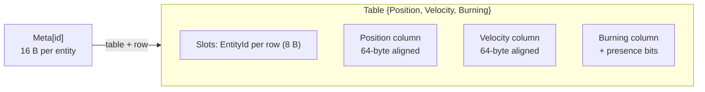
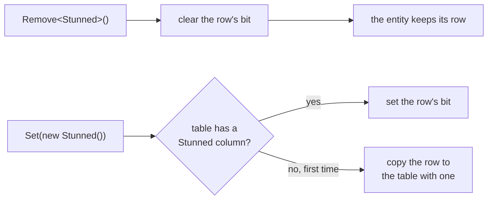
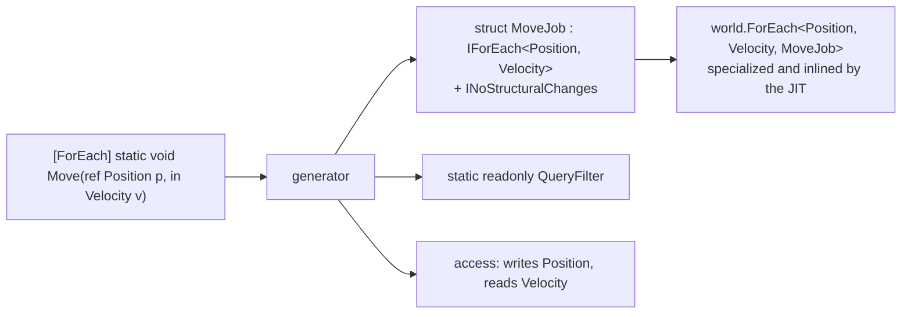
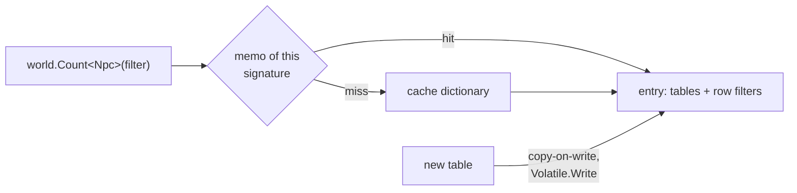
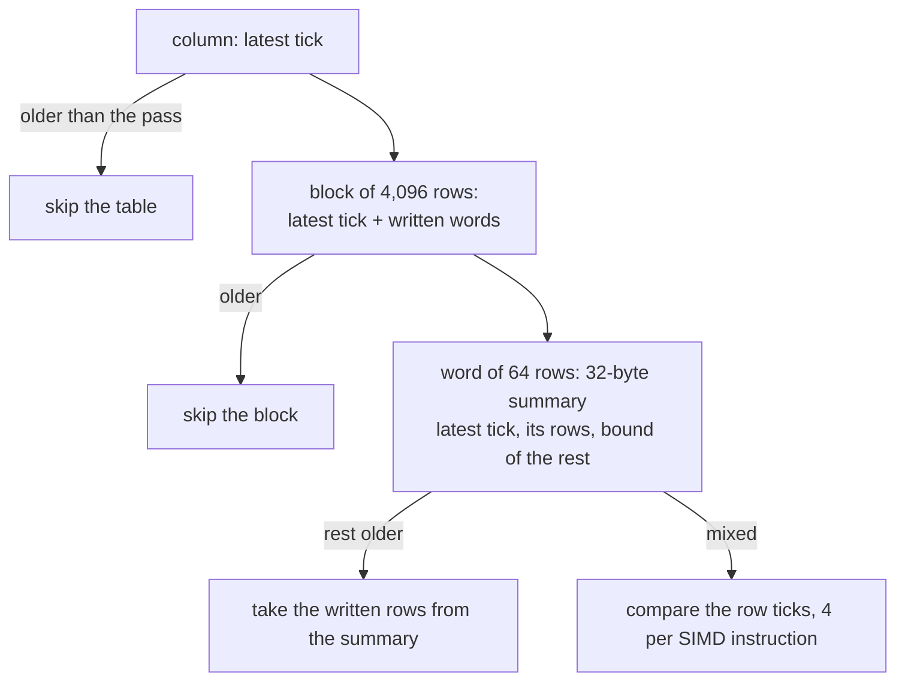
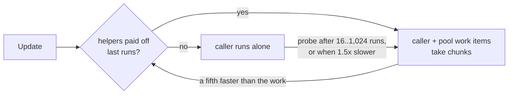

EasyEcs is fast because a server tick does the least work the data allows: it walks dense, aligned columns, skips 64
rows with one bit test, calls your code without a delegate, changes structure without a command buffer and
allocates nothing. None of this needs you to write unusual code: a plain `[ForEach]` method gets all of it. Each
section below names one mechanism, where it lives in the source and the benchmark that measures it.

<Stats>
  <Stat k="forEach.perEntity" label="A [ForEach] write, per entity">two plain arrays take <BenchValue k="rawArray.perEntity" /></Stat>
  <Stat k="changed.10.speedup" label="[Changed<T>] over a full scan">10 of 100,000 rows written since the last run</Stat>
  <Stat k="tick.oneWorld.alloc" label="Allocated per server tick">100,000 entities, after warm-up</Stat>
</Stats>

## The short answer [#summary]

| Mechanism | What it saves | Measured |
| --- | --- | --- |
| [Archetype tables, 64-byte-aligned columns](#archetype-tables) | Pointer chasing and split cache lines | <BenchValue k="forEach.perEntity" /> per entity, below two plain arrays (<BenchValue k="rawArray.perEntity" />) |
| [16-byte entity records](#entity-records) | A second lookup per handle access | `MicroBenchmarks.HandleAccess` |
| [Presence bits](#presence-bits) | A row copy per state change | <BenchValue k="ops.toggle" /> against <BenchValue k="ops.toggle.friflo" /> for Friflo, which moves rows |
| [Generated struct jobs](#generated-jobs) | A delegate call per row | <BenchValue k="runner.runner" /> against <BenchValue k="runner.query" /> for a `Query` loop |
| [Lock-free query cache](#query-cache) | Locks and table searches per call | <BenchValue k="callsite.once" /> per query call |
| [Change-tick summaries](#change-ticks) | Visiting rows nobody wrote | <BenchValue k="changed.10" /> against <BenchValue k="changed.10.scan" /> for a scan |
| [Immediate structural changes](#structural-changes) | Recording and replaying a command buffer | `StructuralChangeComparison` |
| [Zero allocation](#zero-allocation) | GC pauses | <BenchValue k="tick.oneWorld.alloc" /> per tick |
| [SIMD](#simd) | One instruction per row or per word | <BenchValue k="count.tested" /> to count 100,000 rows bit by bit |
| [The parallel runner](#parallel-runner) | Waking threads that do not pay | <BenchValue k="parallel.forEach.on" /> against <BenchValue k="parallel.forEach.off" /> |

<BenchSource />

## Archetype tables with aligned columns [#archetype-tables]

Entities with the same set of components share a table (an archetype): one column per component type, one row per
entity, structure of arrays. A system walks the columns it needs front to back, which is the access pattern hardware
prefetchers and vector units handle best.

- **Unmanaged columns are pinned and aligned.** A column of a type without references is a byte array on the pinned
  object heap whose row 0 starts on the first 64-byte boundary (`Archetype.Aligned`). A row of a power-of-two-sized
  component never straddles two cache lines, vector loads stay aligned, and the GC never scans or moves the column.
- **Columns are contiguous**, not pages: a handle access is one indexed load. Paging would only save the copy when a
  table grows, which `InitialEntityCapacity` removes ([D7](/en/docs/decisions)).
- **Each row's entity is one 8-byte `EntityId`** (version and index side by side), so a handle is built with one load.
- **Moves follow cached edges.** Gaining a component the table has no column for copies the row to the target table
  along a transition cached per component bit (and per generic signature for several components), with a copy plan
  computed once per edge.

The aligned columns are why the generated job beats the same loop over two plain arrays:

<BenchChart
  bench="MicroBenchmarks"
  methods="RawArrayWrite,ForEachSystemWrite,ForEachWrite"
  title="Add Velocity to Position for 10,000 entities"
  subtitle="RawArrayWrite is two plain arrays, the floor without an ECS. ForEachSystemWrite is a [ForEach] system, ForEachWrite a hand-written struct job."
/>

## 16-byte entity records [#entity-records]

Everything the world keeps per entity id is one `EntityMeta`: its table, its version and its row, 16 bytes, so four
fit in a 64-byte cache line (`EntityMeta.cs`). The component set is the table's mask, not a per-entity copy.
`entity.Get<T>()` is a version check on that record, a column lookup in the table (bit to column, one small array
whose 16-byte entries hold the column and its presence bits) and one indexed load.

- Ids are recycled last in, first out: a freed id's cache lines are still warm when it comes back, and the records
  stay bounded by the peak number of live entities.
- The records never shrink, which lets handles index them without bounds checks.

<BenchTable
  bench="MicroBenchmarks"
  methods="HandleAccess,TryGetEntity,TrackedHandleWrite,SingletonAccess"
/>

Each row repeats its call 1,000 times.

## Presence bits [#presence-bits]

Removing a component does not move the entity. The row keeps its place and clears one bit in the column's presence
bits (64 rows per `ulong`); adding the component back sets the bit again ([D6](/en/docs/decisions)). Only gaining a
component the table has no column for moves the row, so a state that comes and goes (stunned, burning, dead) costs a
bit flip after the first time.

Queries read the bits too. Each column counts its rows lacking the component, so per table a pass knows whether to
skip it, walk every row with no test, or test bits, 64 rows per load. A rare state in a large table costs a pass
over the words where it is set:

<BenchChart
  bench="SparseBenchmark"
  title="10 burning units among 100,000 in one table"
  subtitle="Only presence bits tell them apart. The pass over the few skips the words without a burning row; the pass over the rest spans whole words."
/>

Archetype libraries without presence bits move the entity to another table and back:

<BenchChart bench="OperationBenchmark" methods="EasyEcs_Toggle,Friflo_Toggle" title="Stun 5% of 100,000 fighters, then recover them" />

## Generated struct jobs instead of delegates [#generated-jobs]

A `[ForEach]` method is compiled into a struct job by the source generator, and the world runs it through a generic
method constrained to that struct: `world.ForEach<Position, Velocity, MoveJob>(ref job, in filter)`. The JIT
specializes the row loop for each job type and inlines your method into it. There is no delegate, no virtual call
per row and no closure.

What the generator also decides for you:

- **`INoStructuralChanges`** when the method is static, takes no `World` and uses its `Entity` only to read: the
  pass then skips the bookkeeping that keeps structural changes safe. A method that does change structure gets the
  safe loop.
- **`Writes`**, from the `ref` parameters, so a structural change mid-pass carries exactly those writes to the
  entity's new row, and tracked components count as written only through `ref`.
- **The system's access** (reads and writes per component and singleton), which decides which systems may share a
  [parallel stage](#parallel-runner).
- **The filter** as a `static readonly` field, built once.

The generated code reaches private methods through `UnsafeAccessor`, so systems need no `partial` and the call
compiles to a direct call. A static `[ForEach]` method outside a system gets an entry point that takes the world:
it runs as fast as the struct job it replaces, written by hand.

<BenchChart
  bench="RunnerBenchmark"
  title="Count the wounded of 100,000 fighters outside a system"
  subtitle="Runner: a static [ForEach] method's generated entry point. HandWrittenJob: the struct job it replaces. Query: a foreach loop."
/>

## Lock-free query cache snapshots [#query-cache]

A query call does not search tables. The world keeps a cache keyed by the query's components and filter sets
(required, excluded, any, changed, removed); each entry is an immutable snapshot of the matching tables and one row
filter per table. When a new table appears, every matching entry is replaced copy-on-write and published with
`Volatile.Write`, so readers never lock and never see a list being changed. In front of the cache, each call
signature keeps a small memo of its first four filters, and a `QueryFilter` holds no object reference, so building
one is a plain struct copy ([D18](/en/docs/decisions)).

<BenchChart
  bench="CallSiteBenchmark"
  title="The cost of a query call: counting a few entities"
  subtitle="FilterAtCall builds the filter at the call; FilterOnce keeps it in a static field; NoFilter passes none; PastTheMemo uses a fifth filter, past the memo."
/>

## Change-tick summaries per word and per block [#change-ticks]

A component marked `ITrackChanges` gets a hidden column of 8-byte ticks: each row's tick of its last write. On top
of it the table keeps summaries ([D23](/en/docs/decisions)):

A `[Changed<T>]` pass skips a table nobody wrote with one load, then unwritten blocks, then unwritten words (four
summaries per SIMD compare), and finds the next written word of a block with one bit scan. Removing a tracked
component stamps the row's tick while the row clears its presence bit, so `[Removed<T>]` needs no extra storage, and
its own block summaries keep writes of `T` from making it visit their words. Components without `ITrackChanges` have
no column and no stamping code: the checks are JIT-time constants.

<BenchChart
  bench="ChangeTrackingBenchmark"
  param="Written=10"
  title="Replicate the 10 of 100,000 entities written since the last run"
  subtitle="Changed=True: a [Changed<Health>] system or a Changed filter. Changed=False: visiting every row. Tick is a system, QueryTick an ad-hoc Query."
/>

## Immediate structural changes [#structural-changes]

Adding, removing, creating and destroying apply at once, also in the middle of a pass over the same table
([D2](/en/docs/decisions)). Other libraries record such changes in a command buffer and replay them later, which
costs a record per change and a second walk. EasyEcs pays only inside passes:

- While a pass runs, a row that loses its entity becomes a tombstone (a negative id) instead of being filled, so rows
  never shift under the pass. The last pass to end closes the tombstones with vectorized scans.
- A pass records each table's row count before it walks, so entities created or moved in during the pass are not
  visited: each entity is visited at most once.
- Every change that can reallocate storage, move rows or flip presence bits bumps `StorageVersion`. The row loop
  checks it after each entity and re-reads its column refs only when it changed. Tables without tombstones run a row
  loop compiled without the tombstone check ([D25](/en/docs/decisions)).

<Tabs items={['10 killed', '1,000 killed']}>
<Tab value="10 killed">

<BenchChart bench="StructuralChangeComparison" param="Killed=10" title="Mark the dead and revive them during two passes over 100,000 units" />

</Tab>
<Tab value="1,000 killed">

<BenchChart bench="StructuralChangeComparison" param="Killed=1000" title="Mark the dead and revive them during two passes over 100,000 units" />

</Tab>
</Tabs>

## Zero allocation [#zero-allocation]

A busy world allocates nothing per tick, so a long-running server has no GC pauses from the ECS. The rule is enforced,
not hoped for: `AllocationTests` run a frame of updates, queries, structural changes, tracked removals, index churn,
prefab waves, relations, cascades and parallel passes 100 times after warm-up and require
`GC.GetAllocatedBytesForCurrentThread()` to be unchanged, on every `dotnet test`.

What makes it hold:

- **Struct jobs and struct enumerators**: no delegate, no closure, no boxing on any iteration path.
- **Pooled cold state**: a `Query` walk's per-table bookkeeping lives in a `QueryWalk` pooled per thread and nesting
  level.
- **Caches built once**: transition edges, query entries, prefab target tables and overflow masks are allocated when
  first needed, never on the steady path.
- **Bounded growth**: tables double when full and never shrink, ids are recycled, buffers are reused.
- **The parallel runner** uses reusable thread-pool work items, not `Parallel.For` (a closure and state per call).

The same tick in other libraries, with what each allocates per tick:

<PeerChart />

`AllocationTests` once caught a lambda that captured locals in `World.Update`: the closure was allocated at method
entry even when its branch was not taken. That is the kind of regression the test exists for.

## SIMD [#simd]

Vector instructions appear where they measure ([D21](/en/docs/decisions)):

| Where | What is vectorized |
| --- | --- |
| Table matching | Component masks are 256-bit `Vector256` bitsets: one test per table for the first 256 component types |
| `Count` / `Any` on tables whose rows must be tested | The set bits of the row words, 8 words per step with AVX-512 (`Vector512`), else `Vector<T>` |
| Change filters | Word summaries 4 per compare; row ticks of mixed words 4 per instruction |
| Writes of a run of rows | One vectorized fill of their ticks |
| Closing tombstones | Rows read as `long`s and searched for negative ids |
| Your systems | Batch `[ForEach]` methods take spans of aligned columns, ready for `Vector<T>` |

<BenchTable bench="CountBenchmark" />

<BenchChart
  bench="OperationBenchmark"
  methods="EasyEcs_Iterate2,EasyEcs_Iterate2Simd,Friflo_Iterate2,Friflo_Iterate2Simd"
  title="Movement over 100,000 entities: per entity and as a vectorized batch method"
/>

## The parallel runner [#parallel-runner]

Parallel work runs on the calling thread plus up to `MaxDegreeOfParallelism - 1` reusable `IThreadPoolWorkItem`
helpers ([D22](/en/docs/decisions)). Two kinds of work use it:

- **Parallel stages**: with `WorldOptions.ParallelSystems`, consecutive systems with no order between them and no
  conflicting access (from the generated access sets) form one stage and run at once.
- **`[ForEach(Parallel = true)]`**: a method's rows run in chunks, a multiple of 64 rows (so presence-bit words never
  straddle chunks), about four per thread, between 1,024 and 16,384 rows.

Each job and each stage measures its own runs: helpers stay while they make a run at least a fifth faster than its
work, and a job that runs alone probes again after a period that doubles from 16 to 1,024 runs. Waking a parked pool
thread costs from a few to a few hundred microseconds, so a small pass between ticks runs alone instead of burning
CPU. There is no spinning and no dedicated thread.

<BenchChart bench="ParallelForEachBenchmark" title="Steering 100,000 entities, one thread and parallel" />
<BenchChart bench="ParallelSystemsBenchmark" title="Four independent systems, sequential and as one parallel stage" />

The reference machine has 4 cores, and the parallel rows of this run carry a large error: read them as "faster on
several cores", not as a precise speed-up.

## What it costs [#trade-offs]

The same choices have prices, and they are deliberate:

- **Gaining a new component copies the row** to another table. The first time a state appears on an entity it moves;
  after that it flips a bit.
- **Tables never shrink.** Memory is bounded by the peak number of entities each table held.
- **One owner thread per world.** Structural changes and component writes belong to it ([D13](/en/docs/decisions));
  parallelism comes from parallel stages, parallel methods and one world per thread.
- **.NET 10 only** ([D15](/en/docs/decisions)): no Unity, no older runtimes.

## Related [#related]

<Cards>
  <Card title="Performance guide" href="/en/docs/performance">
    Which API to pick, the rewrites that pay and every benchmark.
  </Card>
  <Card title="Architecture" href="/en/docs/architecture">
    Storage, transitions, the query cache and passes in detail.
  </Card>
  <Card title="Design decisions" href="/en/docs/decisions">
    Why each choice was made, what was weighed and the numbers.
  </Card>
  <Card title="Comparison" href="/en/docs/comparison">
    The same work in Friflo.Engine.ECS, Arch and DefaultEcs.
  </Card>
</Cards>
