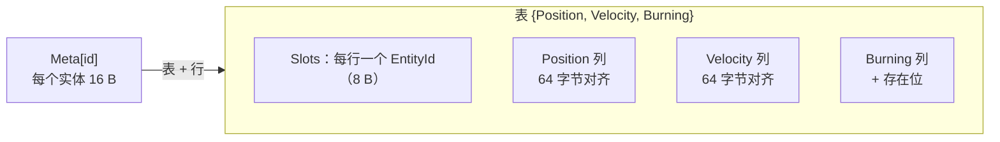
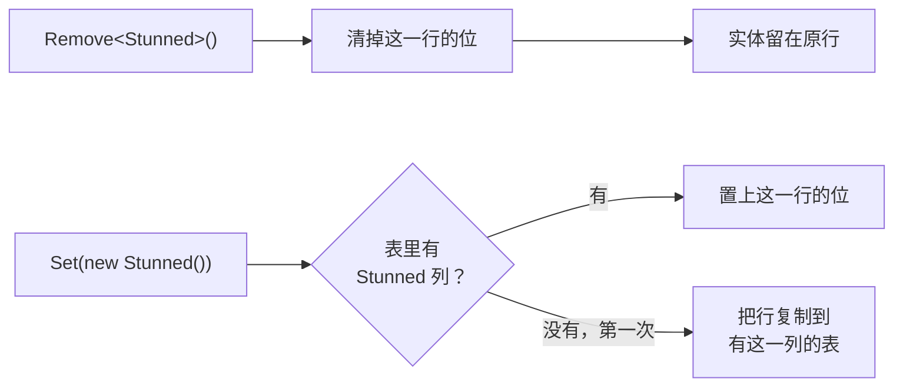
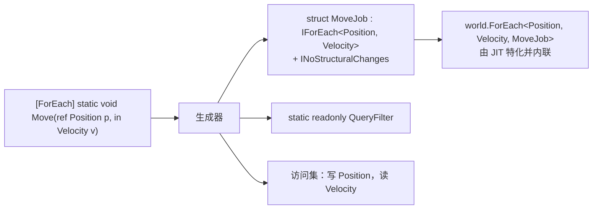
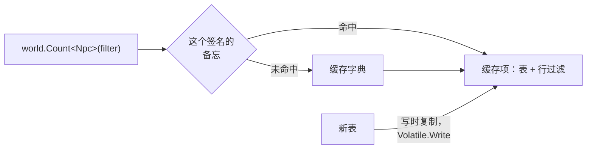
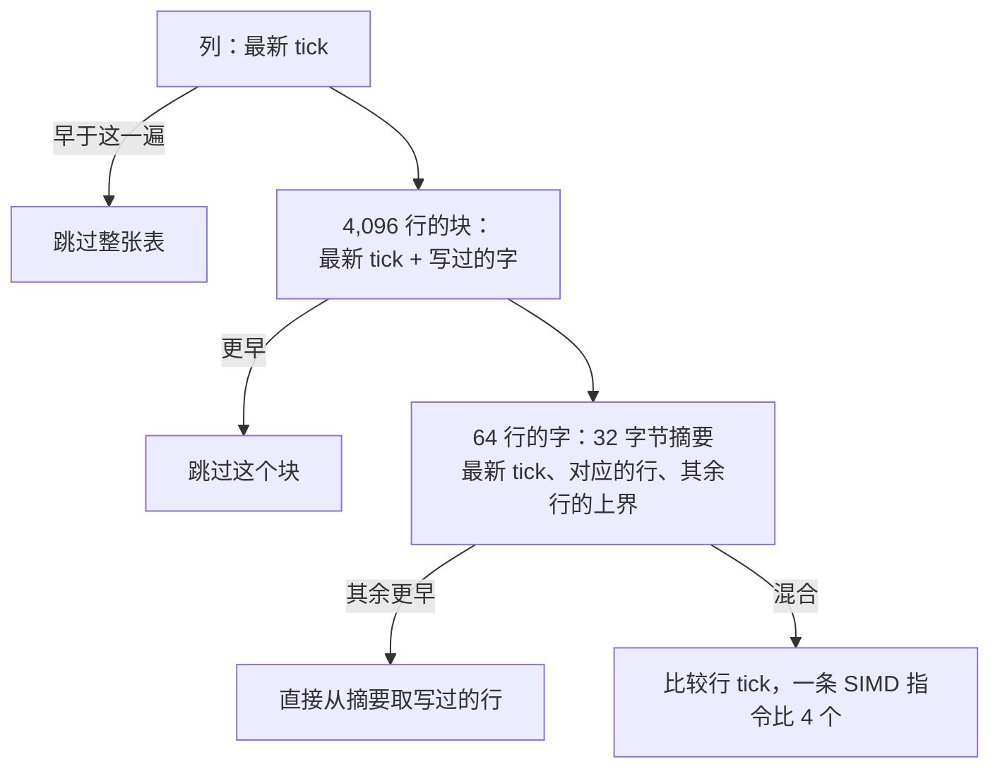
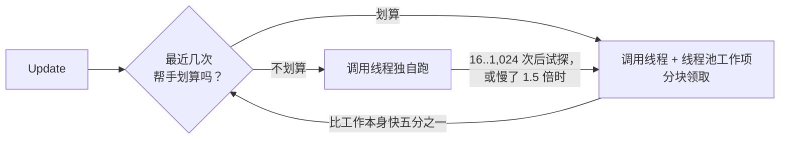

EasyEcs 快，是因为一个服务器 tick 只做数据允许的最少的活：顺着紧凑、对齐的列走，一次位测试跳过 64 行，调用你的代码
不经过委托，结构变更不走命令缓冲，而且不分配。这些都不需要写特殊的代码：普通的 `[ForEach]` 方法就全都用上了。下面每一节
讲一个机制、它在源码里的位置，以及测量它的跑分。

## 简短的回答 [#summary]

| 机制 | 省掉了什么 | 实测 |
| --- | --- | --- |
| [原型表，64 字节对齐的列](#archetype-tables) | 指针追逐和跨缓存行 | 每个实体 <BenchValue k="forEach.perEntity" />，比两个普通数组（<BenchValue k="rawArray.perEntity" />）还快 |
| [16 字节的实体记录](#entity-records) | 每次句柄访问多一次查找 | `MicroBenchmarks.HandleAccess` |
| [存在位](#presence-bits) | 每次状态变化复制一次行 | <BenchValue k="ops.toggle" />，Friflo 要挪行，用 <BenchValue k="ops.toggle.friflo" /> |
| [生成的 struct job](#generated-jobs) | 每行一次委托调用 | <BenchValue k="runner.runner" />，`Query` 循环用 <BenchValue k="runner.query" /> |
| [无锁查询缓存](#query-cache) | 每次调用的锁和查表 | 每次查询调用 <BenchValue k="callsite.once" /> |
| [变更 tick 摘要](#change-ticks) | 访问没人写过的行 | <BenchValue k="changed.10" />，全扫描用 <BenchValue k="changed.10.scan" /> |
| [当场生效的结构变更](#structural-changes) | 记录并回放命令缓冲 | `StructuralChangeComparison` |
| [零分配](#zero-allocation) | GC 停顿 | 每个 tick <BenchValue k="tick.oneWorld.alloc" /> |
| [SIMD](#simd) | 每行或每个字一条指令 | 逐位统计 100,000 行用 <BenchValue k="count.tested" /> |
| [并行调度器](#parallel-runner) | 唤醒不划算的线程 | <BenchValue k="parallel.forEach.on" />，单线程 <BenchValue k="parallel.forEach.off" /> |

<BenchSource />

## 列对齐的原型表 [#archetype-tables]

组件组合相同的实体共用一张表（原型，archetype）：每种组件一列，每个实体一行，即数组结构（SoA）。系统从头到尾走它需要
的列，这正是硬件预取和向量单元最擅长的访问方式。

- **非托管列固定并对齐。** 不含引用的类型，它的列是固定对象堆（POH）上的一个字节数组，第 0 行从第一个 64 字节边界开始
  （`Archetype.Aligned`）。大小为 2 的幂的组件，一行永远不会跨两个缓存行；向量加载保持对齐；GC 也从不扫描、移动这一列。
- **列是连续的**，不分页：一次句柄访问就是一次下标加载。分页只能在表增长时省一次复制，而 `InitialEntityCapacity`
  本来就能省掉这次复制（[D7](/zh/docs/decisions)）。
- **每行的实体是一个 8 字节的 `EntityId`**（版本和下标挨着放），一次加载就能构造句柄。
- **搬行走缓存的边。** 多了一个表里没有列的组件时，行沿着按组件位缓存的转移边（多个组件时按泛型签名）复制到目标表，
  复制方案每条边只算一次。

生成的 job 能跑赢同样的循环写在两个普通数组上，靠的就是对齐的列：

<BenchChart
  bench="MicroBenchmarks"
  methods="RawArrayWrite,ForEachSystemWrite,ForEachWrite"
  title="给 10,000 个实体的 Position 加上 Velocity"
  subtitle="RawArrayWrite 是两个普通数组，即没有 ECS 时的下限。ForEachSystemWrite 是 [ForEach] 系统，ForEachWrite 是手写的 struct job。"
/>

## 16 字节的实体记录 [#entity-records]

World 为每个实体 id 保存的全部信息就是一个 `EntityMeta`：所在的表、版本和行号，共 16 字节，一条 64 字节的缓存行能放
四个（`EntityMeta.cs`）。组件组合就是表的掩码，不为每个实体单独存一份。`entity.Get<T>()` 就是：在这条记录上校验版本，
在表里查列（位到列的映射，一个小数组，每项 16 字节，放着列和它的存在位），再做一次下标加载。

- id 按后进先出回收：释放的 id 回来时，它的缓存行还是热的；记录数量也以存活实体数的峰值为上限。
- 记录从不收缩，所以句柄访问可以省掉边界检查。

<BenchTable
  bench="MicroBenchmarks"
  methods="HandleAccess,TryGetEntity,TrackedHandleWrite,SingletonAccess"
/>

每一行把调用重复 1,000 次。

## 存在位 [#presence-bits]

移除组件不会挪动实体。行留在原处，只清掉该列存在位里的一位（每个 `ulong` 管 64 行）；再加回来就把这一位置上
（[D6](/zh/docs/decisions)）。只有多出一个表里没有列的组件时才搬行，所以来来去去的状态（眩晕、着火、死亡）第一次之后
只要翻一个位。

查询也读这些位。每一列都记着缺这个组件的行数，所以每张表一遍遍历就能知道：整张跳过、每行都不用测，还是要测位（一次加载
64 行）。大表里的稀有状态，只需要走它所在的那些字：

<BenchChart
  bench="SparseBenchmark"
  title="一张表里 100,000 个单位中有 10 个着火"
  subtitle="只能靠存在位区分它们。遍历少数的那一遍跳过没有着火行的字；遍历其余的那一遍走完整的字。"
/>

没有存在位的原型库，要把实体搬到另一张表，再搬回来：

<BenchChart bench="OperationBenchmark" methods="EasyEcs_Toggle,Friflo_Toggle" title="眩晕 100,000 个战斗单位中的 5%，再让他们恢复" />

## 用生成的 struct job 代替委托 [#generated-jobs]

源生成器把 `[ForEach]` 方法编译成一个 struct job，World 通过一个约束到该 struct 的泛型方法来运行它：
`world.ForEach<Position, Velocity, MoveJob>(ref job, in filter)`。JIT 为每种 job 类型特化行循环，并把你的方法内联进去。
没有委托，每行没有虚调用，也没有闭包。

生成器还替你决定了这些：

- **`INoStructuralChanges`**：方法是静态的、不拿 `World`、只读 `Entity` 时加上，遍历就能省掉保证结构变更安全的那些簿记。
  会改结构的方法用安全的循环。
- **`Writes`**，来自 `ref` 参数：遍历途中做结构变更时，正好把这些写入带到实体的新行；被追踪的组件也只在 `ref` 时算写过。
- **系统的访问集**（每个组件和单例的读写），决定哪些系统可以同处一个[并行阶段](#parallel-runner)。
- **过滤**，作为 `static readonly` 字段，只构造一次。

生成的代码通过 `UnsafeAccessor` 调用私有方法，所以系统不需要 `partial`，调用编译成直接调用。系统之外的静态 `[ForEach]`
方法会得到一个以 World 为参数的入口，跑得和它替代的手写 struct job 一样快。

<BenchChart
  bench="RunnerBenchmark"
  title="在系统之外统计 100,000 个战斗单位里的伤员"
  subtitle="Runner：静态 [ForEach] 方法生成的入口。HandWrittenJob：它替代的 struct job。Query：一个 foreach 循环。"
/>

## 无锁的查询缓存快照 [#query-cache]

一次查询调用不会去搜表。World 按查询的组件和各类过滤集合（必需、排除、任一、变更、移除）维护一个缓存；每一项都是一个
不可变快照，包含匹配的表和每张表一个行过滤。出现新表时，所有匹配的项按写时复制替换，用 `Volatile.Write` 发布，所以读者
从不加锁，也不会看到正在修改的列表。缓存前面，每个调用签名还有一个小备忘，记住它的前四个过滤；`QueryFilter` 不含任何
对象引用，构造一个就是复制一个普通 struct（[D18](/zh/docs/decisions)）。

<BenchChart
  bench="CallSiteBenchmark"
  title="一次查询调用的开销：统计少量实体"
  subtitle="FilterAtCall 在调用处构造过滤；FilterOnce 把它放在静态字段里；NoFilter 不传过滤；PastTheMemo 用第五个过滤，超出了备忘。"
/>

## 按字、按块的变更 tick 摘要 [#change-ticks]

标记了 `ITrackChanges` 的组件会多一列隐藏的 8 字节 tick：每行最后一次写入的 tick。表在它之上再维护几层摘要
（[D23](/zh/docs/decisions)）：

`[Changed<T>]` 遍历用一次加载跳过没人写过的表，再跳过没写过的块、没写过的字（一次 SIMD 比较 4 个摘要），用一次位扫描
找到块里下一个写过的字。移除被追踪的组件时，行清掉存在位的同时记下 tick，所以 `[Removed<T>]` 不需要额外存储；它有自己
的块摘要，`T` 的写入不会让它去访问那些字。没有 `ITrackChanges` 的组件既没有这一列，也没有记 tick 的代码：这些判断在 JIT
时就是常量。

<BenchChart
  bench="ChangeTrackingBenchmark"
  param="Written=10"
  title="同步上次运行以来写过的实体：100,000 个里的 10 个"
  subtitle="Changed=True：[Changed<Health>] 系统或 Changed 过滤。Changed=False：访问每一行。Tick 是系统，QueryTick 是临时 Query。"
/>

## 当场生效的结构变更 [#structural-changes]

添加、移除、创建和销毁都当场生效，遍历同一张表的途中也一样（[D2](/zh/docs/decisions)）。别的库把这类变更记进命令缓冲，
之后再回放，每次变更要记一条，还要再走一遍。EasyEcs 只在遍历期间付出代价：

- 遍历进行时，失去实体的行变成墓碑（负的 id），不去填补，所以行不会在遍历下面移动。最后一个结束的遍历用向量化扫描
  关闭墓碑。
- 遍历开始前记下每张表的行数，遍历期间新建或搬进来的实体不会被访问：每个实体最多访问一次。
- 任何可能重新分配存储、搬行或翻存在位的变更都会递增 `StorageVersion`。行循环每处理完一个实体检查一次，只有变了才
  重新读取列引用。没有墓碑的表跑的是去掉墓碑检查的行循环（[D25](/zh/docs/decisions)）。

<Tabs items={['击杀 10 个', '击杀 1,000 个']}>
<Tab value="击杀 10 个">

<BenchChart bench="StructuralChangeComparison" param="Killed=10" title="两遍遍历 100,000 个单位时标记死亡再复活" />

</Tab>
<Tab value="击杀 1,000 个">

<BenchChart bench="StructuralChangeComparison" param="Killed=1000" title="两遍遍历 100,000 个单位时标记死亡再复活" />

</Tab>
</Tabs>

## 零分配 [#zero-allocation]

一个繁忙的 World 每个 tick 都不分配，长期运行的服务器不会因为 ECS 出现 GC 停顿。这条规则是强制的，不是指望出来的：
`AllocationTests` 把一帧更新、查询、结构变更、追踪的移除、索引变动、预制体波次、关系、级联和并行遍历在预热后跑 100 次，
要求 `GC.GetAllocatedBytesForCurrentThread()` 不变，每次 `dotnet test` 都会跑。

靠这些做到：

- **struct job 和 struct 枚举器**：任何遍历路径上都没有委托、闭包和装箱。
- **池化的冷状态**：`Query` 遍历的每表簿记放在 `QueryWalk` 里，按线程和嵌套层级池化。
- **只构造一次的缓存**：转移边、查询缓存项、预制体目标表和溢出掩码都在第一次需要时分配，稳态路径上从不分配。
- **有界增长**：表满了翻倍，从不收缩；id 回收；缓冲复用。
- **并行调度器** 用可复用的线程池工作项，不用 `Parallel.For`（每次调用一个闭包和状态）。

同一个 tick 在别的库里，以及各自每 tick 的分配：

<PeerChart />

`AllocationTests` 曾经抓到 `World.Update` 里一个捕获局部变量的 lambda：哪怕那个分支没走，闭包在进入方法时就已经分配了。
这个测试存在的意义就是抓这种回退。

## SIMD [#simd]

向量指令只用在测得出收益的地方（[D21](/zh/docs/decisions)）：

| 位置 | 向量化了什么 |
| --- | --- |
| 匹配表 | 组件掩码是 256 位的 `Vector256` 位集：前 256 种组件类型，每张表一次测试 |
| 需要逐行测试的表上的 `Count` / `Any` | 行字里置位的数量，AVX-512（`Vector512`）下一步 8 个字，否则用 `Vector<T>` |
| 变更过滤 | 字摘要一次比 4 个；混合字的行 tick 一条指令比 4 个 |
| 一段连续行的写入 | 一次向量化填充它们的 tick |
| 关闭墓碑 | 把行当作 `long` 读，搜索负的 id |
| 你的系统 | 批量 `[ForEach]` 方法拿到对齐列的 span，可以直接用 `Vector<T>` |

<BenchTable bench="CountBenchmark" />

<BenchChart
  bench="OperationBenchmark"
  methods="EasyEcs_Iterate2,EasyEcs_Iterate2Simd,Friflo_Iterate2,Friflo_Iterate2Simd"
  title="100,000 个实体的移动：逐实体和向量化的批量方法"
/>

## 并行调度器 [#parallel-runner]

并行工作在调用线程加上最多 `MaxDegreeOfParallelism - 1` 个可复用的 `IThreadPoolWorkItem` 帮手上运行
（[D22](/zh/docs/decisions)）。用到它的有两种工作：

- **并行阶段**：开启 `WorldOptions.ParallelSystems` 后，相邻、彼此没有顺序约束、访问也不冲突（由生成的访问集判断）的
  系统组成一个阶段，同时运行。
- **`[ForEach(Parallel = true)]`**：方法的行按块运行，块大小是 64 行的倍数（存在位的字不会跨块），每个线程约四块，
  在 1,024 到 16,384 行之间。

每个 job、每个阶段都测量自己的运行：只要帮手能让一次运行至少快五分之一，就留着；独自运行的 job 隔一段时间再试探，间隔
从 16 次翻倍到 1,024 次。唤醒一个停放的线程池线程要几微秒到几百微秒，所以两个 tick 之间的小遍历宁可独自跑，也不白烧
CPU。没有自旋，也没有专用线程。

<BenchChart bench="ParallelForEachBenchmark" title="驱动 100,000 个实体，单线程与并行" />
<BenchChart bench="ParallelSystemsBenchmark" title="四个互不相关的系统，串行与作为一个并行阶段" />

参考机器只有 4 核，而且这次运行的并行数字误差很大：把它们理解为“多核下更快”，不要当成精确的加速比。

## 代价 [#trade-offs]

同样的选择也有代价，而且是刻意的：

- **多出一个新组件要复制整行** 到另一张表。某个状态第一次出现在实体上时要搬一次；之后只翻一个位。
- **表从不收缩。** 内存以每张表曾经容纳的实体数峰值为上限。
- **每个 World 只属于一个线程。** 结构变更和组件写入都归它（[D13](/zh/docs/decisions)）；并行来自并行阶段、并行方法
  和每个线程一个 World。
- **只支持 .NET 10**（[D15](/zh/docs/decisions)）：不支持 Unity，也不支持更老的运行时。

## 相关页面 [#related]

<Cards>
  <Card title="性能指南" href="/zh/docs/performance">
    该选哪个 API、值得做的改写，以及全部跑分。
  </Card>
  <Card title="架构" href="/zh/docs/architecture">
    存储、转移、查询缓存和遍历的细节。
  </Card>
  <Card title="设计决策" href="/zh/docs/decisions">
    每个选择的理由、权衡过什么，以及数字。
  </Card>
  <Card title="对比" href="/zh/docs/comparison">
    同样的工作在 Friflo.Engine.ECS、Arch 和 DefaultEcs 里。
  </Card>
</Cards>
